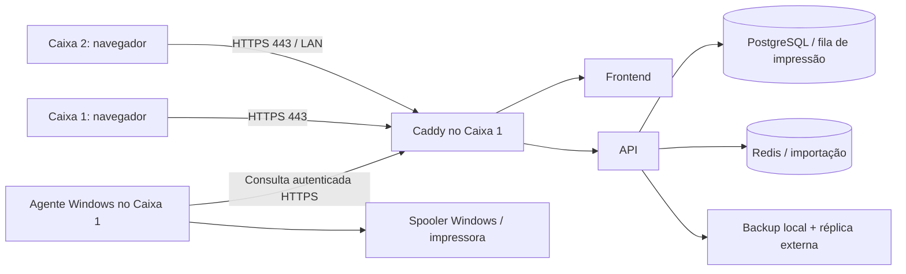
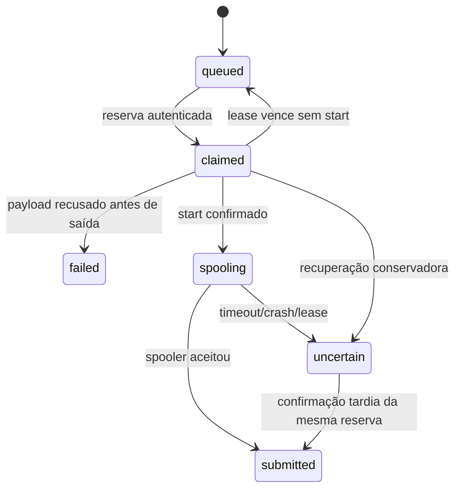

# Instalador Windows — documentação técnica

## Escopo e arquitetura

Implantação prevista: dois caixas Windows x64, uma impressora central e uma instância de loja. O Principal hospeda Docker Desktop Linux/amd64, PostgreSQL 16, Redis 7, API, frontend Nginx e proxy Caddy. O Terminal usa navegador. O agente de impressão é um processo Node Windows sem servidor HTTP e faz conexões de saída HTTPS.



Apenas 443 é publicada, no IP privado selecionado. Não há publicação de PostgreSQL, Redis, API, métricas ou porta 9222. O proxy usa IP estático `172.29.73.2` na rede Docker `172.29.73.0/24`, com alocação dinâmica restrita a `172.29.73.128/25` para preservar o endereço estático do proxy; a API confia somente nesse proxy para identificar o IP de origem. Se essa sub-rede conflitar com a infraestrutura, prepare/homologue outra configuração de release antes de instalar; não altere somente a confiança do proxy de forma avulsa.

O instalador não seleciona o Compose de desenvolvimento. Gera um projeto estável `pos-store-<8 caracteres do UUID da loja>`. Os volumes de PostgreSQL, Redis/AOF, Caddy/CA, backups e arquivos de importação pertencem a esse projeto. Persistência de arquivos/Redis melhora a instalação, mas não conclui a idempotência/publicação da importação pendente no roadmap.

## Componentes e arquivos

| Arquivo de fonte | Responsabilidade |
|---|---|
| `infra/installer/Launcher.cs` | Executável x64/.NET: valida caminhos, hashes e arquivos essenciais antes de iniciar PowerShell. |
| `Instalar-POS.ps1` | GUI WinForms Principal/Terminal; `-ValidateOnly` valida pacote e `-UiCheck` constrói a UI sem exibir/instalar. |
| `Pos.Common.ps1` | Hashes, validação de pacote/IP, ACL privada, DPAPI, argumentos nativos, execução Docker, TLS/identidade e atalhos. |
| `Pos.Install.ps1` | Primeiro provisionamento, reparo da mesma versão, credenciais, backup inicial e exportação do Terminal. |
| `Firewall-POS.ps1` | Único auxiliar elevado: regra TCP443 para IP atribuído, rede Privada e LocalSubnet; permite retirar somente essa regra. |
| `Start-POS.ps1` | Supervisor após login: aguarda Docker, inicia serviços/agente e realiza backup vencido. |
| `Parar-POS.ps1` | Sinal de parada, espera do agente e parada dos containers sem remover dados. |
| `Atualizar-POS.ps1` | Atualização somente de versão explicitamente compatível, com backup prévio e bloqueio após falha. |
| `Desativar-POS.ps1` | Remove inicialização/regra de acesso; mantém volumes e arquivos. |
| `Diagnosticar-POS.ps1` | Saúde, identidade, backup preflight/backup manual, heartbeat e contagens da fila sem imprimir segredos. |
| `Build-Installer.ps1` | Build das imagens, runtime oficial, compilação do launcher, documentação, manifesto e ZIP/SHA256. |
| `Test-Installer.ps1` | Testes Windows reais de parser/DPAPI/ACL/launcher e fluxo com efeitos globais simulados. |
| `agent/src/pull-agent.mjs` | Worker de saída, journal e transporte para Out-Printer. Não depende de npm na loja. |
| `backend/src/modules/print-jobs` | Fila PostgreSQL, autenticação de agente, leases e consultas de estado. |
| `backend/src/scripts/store-backup.ts` | CLI interna de backup gerenciado/preflight, reutilizando lock, réplica, catálogo e retenção existentes. |

## Build e distribuição

No computador de desenvolvimento Windows x64, use Git, Docker Desktop Linux/amd64, PowerShell 5.1 e .NET Framework/csc. O build obtém Node 24.21.0 Windows pelo domínio oficial, verifica o ZIP pelo SHA256 oficial e a assinatura Authenticode de node.exe. As imagens de infraestrutura são fixadas por digest. API/frontend são construídos pelos Dockerfiles/lockfiles; não há compilação na loja.

```powershell
./infra/installer/Test-Installer.ps1 -NodePath (Get-Command node.exe).Source
./infra/installer/Build-Installer.ps1 -Version '1.0.0-store.1'
```

O runtime Windows obtido pelo builder também é usado nos testes; Node instalado localmente não é exigido pelo build. O parâmetro `-NodePath` do teste é opcional para uma execução manual sem Node. O build exige acesso à rede para dependências/imagens/runtime. Seus temporários ficam em uma pasta `pos-store-build-*` sob o Temp do usuário, informada no log.

Saídas:

```text
artifacts/POS-Loja-<versão>/
  Instalar-POS.exe
  Instalar-POS.ps1 / auxiliares PowerShell
  store.compose.yml / Caddyfile / init.sql / empty.env
  runtime/node.exe / LICENSE-node.txt
  agent/pull-agent.mjs
  images.tar
  manifest.json
  documentacao/USO.md / TECNICO.md / HOMOLOGACAO.md
  LEIA-ME.txt
artifacts/POS-Loja-<versão>.zip
artifacts/POS-Loja-<versão>.zip.sha256
```

O diretório `artifacts` é ignorado pelo Git. O builder recusa sobrescrever uma versão já empacotada. O manifesto registra versão, HEAD/árvore suja, horário UTC, imagens por ID de conteúdo, runtime e hashes dos arquivos. Os IDs de imagem são usados no Compose, com `--pull never`. Isso permite carregar o bundle sem recompilar/puxar imagens na loja. Docker/WSL continuam sendo pré-requisitos separados para a primeira instalação; não estão embutidos no ZIP.

Para assinar um release, forneça `-SigningThumbprint` com um certificado de code signing válido no repositório CurrentUser/My. EXE/scripts são assinados antes dos hashes. Sem esse parâmetro, o pacote é explicitamente não assinado. SHA256 verifica integridade, não substitui origem confiável/assinatura; distribua o hash por canal independente e controlado. Nunca embuta certificados privados de assinatura ou credenciais de loja no bundle.

Atualizações futuras precisam declarar a versão de origem após ensaio de upgrade:

```powershell
./infra/installer/Build-Installer.ps1 -Version '1.0.0-store.2' -CompatibleFrom '1.0.0-store.1'
```

`CompatibleFrom` é uma declaração do mantenedor, não uma prova automática de compatibilidade de schema. O gate de release deve incluir migrações, leitura de dados anteriores, backup/restore em alvo isolado e preservação de operações. O problema de checksums/privilégios de migração da TSK-038 continua pendente; não aprove releases apenas por esse campo.

## Instalação, identidade e segredos

A raiz fixa do Principal é `%LOCALAPPDATA%/POSStore`; a do Terminal, `%LOCALAPPDATA%/POSTerminal`. Os diretórios privados recebem DACL protegida para usuário atual, SYSTEM e Administrators, sem alterar proprietário/SACL nem exigir privilégios de auditoria. Links/junctions na raiz privada/do pacote são recusados.

`settings.json` guarda UUID da loja, proprietário SID, projeto, versão, estado, IP, impressora, empresa, destino externo e thumbprint da CA. `secrets.bin` guarda senha do banco, segredo JWT, token de métricas e token do agente, protegidos com **DPAPI CurrentUser**. O bloco de bootstrap é temporário. Dados sensíveis são passados aos processos por ambiente, nunca em argumentos ou logs.

A API recebe apenas SHA256 do token do agente; o token bruto fica no payload DPAPI e no ambiente do worker. Um operador com controle da conta/Docker ainda tem acesso administrativo ao ambiente: DPAPI não é um cofre contra o próprio usuário ou administrador do sistema. Backups SQL contêm dados sensíveis e não são criptografados pela aplicação.

O ambiente do Compose é montado em memória e restaurado no processo ao terminar. `empty.env` impede usar um .env do diretório por engano. Os campos COMPANY_* chegam à API; o frontend usa `/api/v1` relativo, sem URL de API configurada em runtime.

A primeira instalação copia o release para `versions/<versão>`, gera identidade/segredos, carrega e verifica imagens, inicializa banco/perfis, aplica migrações e cria o administrador. Não aplica seeds de benchmark. Só conclui depois de HTTPS, backup com réplica, remoção de bootstrap, recriação da API e regra de acesso privado.

Um lock de arquivo do Windows serializa instalador/atualizador. Reparar preserva identidade e credenciais, para o supervisor antes da intervenção e não aceita mudanças silenciosas de IP/impressora/destino. Estados de atualização incompleta bloqueiam reparo automático para impedir retorno de imagem sobre schema possivelmente incompatível.

## HTTPS, pareamento e rede

Caddy gera CA própria da instalação e certificado para o IP configurado. A opção default_sni seleciona esse certificado para clientes que acessam por IP sem enviar SNI, inclusive através do NAT do Docker. O verificador HTTPS aguarda a emissão inicial mantendo validação de CA/identidade e TLS 1.2. A chave privada permanece no volume caddy_data. O Principal exporta apenas root.crt público e confia nele em CurrentUser/Root. O pacote Terminal contém certificado público, SHA256, UUID/origem da loja, launcher e scripts; não contém segredos, imagens, banco, chave de CA ou agente.

O operador confirma origem/endereço/fingerprint do pareamento. O Terminal verifica hashes locais, importa a CA recebida de fonte confiável, faz HTTPS com validação normal e exige o UUID esperado em `GET /api/v1/store-info`. Não baixa e confia automaticamente em uma CA fornecida pela rede. O agente usa NODE_EXTRA_CA_CERTS; nenhuma validação TLS é desativada.

O auxiliar elevado de firewall valida IP privado atribuído e perfil Privado. A única regra é `POS-HTTPS-<projeto>`, TCP443, LocalAddress escolhido e RemoteAddress LocalSubnet. Não altera classificação de rede, roteador, endereço IP, grupos de administradores, login automático ou regras globais do firewall.

## Inicialização, backup e atualização

O atalho na pasta Inicializar chama PowerShell oculto, no usuário interativo da instalação. O supervisor usa lock de arquivo para evitar instâncias duplicadas e aguarda Docker. Não registra serviço SYSTEM nem pressupõe acesso de Session 0 à impressora. Docker e spooler precisam ser homologados nessa conta após login/reboot.

O worker é iniciado com runtime do release e segredo por ambiente. Há um único agente lógico `principal`. O supervisor registra estado/PIDs em runtime-status.json e tenta backup quando o último sucesso ultrapassa 24h; em falha, tenta depois de uma hora. A agenda depende da sessão/supervisor; não garante execução com PC desligado ou usuário desconectado.

A CLI de backup usa createManagedBackup e o mesmo preflight/lock/replicação/catalogação/retenção da aplicação. Ator nulo identifica execução de sistema, sem fingir um usuário humano. A instalação exige réplica; o caminho externo deve existir e ser acessível no container pelo UID 10001, com capacidade de publicação exclusiva/hardlinks. O verificador não demonstra que o dispositivo está fisicamente fora do host. Réplicas externas não sofrem retenção automática. Arquivos importados e Redis/AOF também têm volumes persistentes, mas isso não garante idempotência da importação.

Parar cria stop.request, impede novos ciclos, espera o worker e para containers; volumes não são removidos. O worker termina o trabalho em andamento antes de observar a parada. Se exceder o budget de encerramento, o supervisor pode terminá-lo; um spool em curso permanece incerto. Retomar exige -Resume e remove o sinal de parada explicitamente.

O atualizador valida o pacote e CompatibleFrom antes de mudar a versão. Faz backup/réplica, prepara imagens, para o supervisor, inicia o novo release e verifica identidade/saúde/preflight. Só então grava versão ativa e retoma. Se houver falha após possível migração, grava update_failed e conserva releases, dados e backups; não executa rollback automático de banco. A desativação conserva dados e remove apenas o mecanismo de início/regra próprios, com retirada opcional da CA do Principal.

## Fila de impressão e invariantes

Migração aditiva: `20261022_001_print_jobs.sql`. A tabela print_job guarda request_id único, sale_id, snapshot de texto/código/cópias/locale, estado, token de reserva e timestamps. print_agent_state registra o último polling. O snapshot é do pedido de impressão, não substitui os snapshots financeiros/históricos ainda pendentes em outras tarefas.



- Enqueue/transição de claim usam advisory lock transacional do único destino. Candidatos são ordenados por data/UUID e reservados com FOR UPDATE SKIP LOCKED.
- request_id UUID deduplica a mesma solicitação. Reuso com venda/cópias/locale diferentes retorna 409. O primeiro texto permanece imutável no retry.
- No máximo um claim/spool vivo para o destino. Lease padrão 120 segundos. Reservas não iniciadas podem voltar à fila; spools expirados tornam-se incertos e não são repetidos automaticamente.
- Conteúdo limitado a 1 MiB e cópias entre 1 e 10. Limite padrão de 500 trabalhos pendentes; ao atingir, novas solicitações recebem 503, preservando retries idempotentes já existentes.
- O agente grava e sincroniza journal antes da fronteira de início, espera /start e só depois chama Out-Printer. Após sucesso/erro, grava resultado antes de confirmar à API.
- Reinício confirma resultados guardados sem chamar a impressora novamente. Journals reconhecidos são arquivados localmente; o journal não guarda conteúdo do recibo. Caso de protocolo inconsistente exige revisão, sem forçar repetição.
- submitted significa aceitação pelo Windows; não comprova papel. Exatamente uma saída física não pode ser garantida por esse transporte. Em resultados incertos, o operador decide por nova via após conferir papel/spooler.

Variáveis da API: PRINT_MODE=queue, PRINT_AGENT_TOKEN_SHA256 (64 hex), PRINT_PRINTER_NAME, PRINT_QUEUE_LEASE_SECONDS (60–600), PRINT_QUEUE_MAX_PENDING (10–10.000, padrão 500), STORE_ID (UUID). O Compose da loja usa queue; a execução anterior de desenvolvimento continua direct por padrão. O antigo agente HTTP/loopback permanece disponível para compatibilidade, mas não é executado pelo instalador.

## Contrato HTTP

Consulte também `backend/openapi/openapi.yaml`, servido pela API.

| Operação | Autorização | Resultado |
|---|---|---|
| GET /api/v1/store-info | Pública | UUID da loja e modo; 503 sem configuração. |
| POST /api/v1/sales/{id}/receipt/print | Sessão + sales:read | request_id obrigatório no modo queue; 202 para trabalho pendente, 200 para resultado já terminal/direct. |
| GET /api/v1/print-jobs/{id} | Sessão + sales:read | Metadados, sem texto/token. |
| GET /api/v1/print-jobs/sale/{id} | Sessão + sales:read | Últimos vinte trabalhos; UI mostra os cinco mais recentes. |
| GET /api/v1/print-jobs/agent-status | Sessão + sales:read | Heartbeat/contagens. |
| POST /api/v1/print-agent/claim | x-print-agent-token | job com texto/token ou null. |
| POST /api/v1/print-agent/jobs/{id}/start | Token de agente + claim_token | 204 ou 409; não imprimir se não confirmado. |
| POST /api/v1/print-agent/jobs/{id}/finish | Token de agente + claim_token | outcome submitted/uncertain/failed; confirmação idempotente. |
| GET /api/v1/print-agent/jobs/{id} | Token de agente | Metadados para recuperação do journal. |
| GET /api/v1/print-agent/status | Token de agente | Diagnóstico local. |

O token de agente é comparado por hash e timingSafeEqual, separado da sessão humana. Rotas de agente ficam antes do middleware de sessão e exigem o token próprio; não ficam abertas. O frontend gera UUID por ação, anuncia fila/resultado em vez de afirmar impressão física e atualiza o histórico enquanto há trabalho pendente. Nunca reenvia impressão como consequência automática de timeout de consulta.

## Dados e recuperação assistida

Não existe procedimento seguro de “desinstalar tudo” que apague volumes. Não use down --volumes no projeto da loja. Preserve settings, secrets.bin, perfil Windows/DPAPI, volumes e cópias externas; secrets.bin não é um kit portátil para outro Windows/usuário.

Em falha: interrompa novas operações, preserve original e cópias, confira hashes e selecione alvo isolado para ensaio. O dump SQL é restaurável com ferramentas PostgreSQL 16 em um ambiente novo, com credenciais novas, após validação técnica. Restauração em uso exige manutenção, journal independente/pinning/cutover e reconciliação — gates ainda pendentes; o instalador não habilita ENABLE_DATABASE_RESTORE. Não rode SQL de recuperação sobre um alvo operacional por tentativa.

Troca de máquina/conta/IP/CA requer plano assistido: backup externo validado, ambiente novo, ensaio de dados, reconfiguração da impressora e novo pareamento dos terminais. Não copie somente o DPAPI ou habilite trust TLS indiscriminadamente.

## Verificação e limites

- Docker: suítes completas, fila com PostgreSQL real, autenticação/concorrência/idempotência/leases e controles de entrada; backup real em banco descartável.
- Windows: parser PowerShell 5.1, DPAPI e ACL reais, argumentos nativos, compilação e execução do launcher, UI construída sem exibição, rejeição de código adulterado antes de executar PowerShell, estado idempotente e pareamento com efeitos globais simulados.
- Integração de release: stack da loja em projeto descartável, HTTPS com CA específica, duas sessões e agente com transporte de saída simulado. Não usa impressora física nem importa CA no Windows de desenvolvimento.
- CI: job Linux para Docker e job Windows para contratos/launcher. O build completo de distribuição precisa de host Windows com Docker Linux; não foi criada publicação remota automática.

Reprodução do ensaio de release, após construir o pacote (requer Node no host e Docker Compose com suporte a `!override`):

```powershell
node infra/installer/test-store.mjs --bundle artifacts/POS-Loja-1.0.0-store.1 --evidence docs/test-evidence/installer-store-20261022.json
```

Esse ensaio usa o projeto fixo `pos-installer-smoke`, volumes próprios sintéticos, porta efêmera somente em loopback e sub-rede de teste `172.29.74.0/24`. Limpa apenas esse projeto no início/fim. Não execute dois ensaios simultâneos. A saída do spooler é injetada/simulada; HTTPS, duas sessões, fila, API, banco, backup e bind externo são reais. O teste não comprova que o diretório temporário de réplica está fisicamente em outro dispositivo.

O checklist [HOMOLOGACAO.md](HOMOLOGACAO.md) registra os ensaios físicos/reboot/rede/backup que precisam ocorrer na loja. A evidência automatizada entregue não certifica drivers, BIOS, rede real, NAS/UNC, assinatura comercial ou regras de negócio pendentes. Não há dependência nova de npm para esta entrega.

Para repetir um ensaio com as mesmas imagens já carregadas, use `--reuse-images`; seus IDs ainda são conferidos contra o manifesto. O primeiro ensaio deve carregar o archive normalmente.

Fontes primárias: [Docker Windows](https://docs.docker.com/desktop/setup/install/windows-install/), [Docker Compose em produção](https://docs.docker.com/compose/how-tos/production/), [Caddy HTTPS local](https://caddyserver.com/docs/automatic-https#local-https), [Caddy default_sni](https://caddyserver.com/docs/caddyfile/options#default-sni), [Microsoft DPAPI](https://learn.microsoft.com/en-us/dotnet/api/system.security.cryptography.protecteddata).
