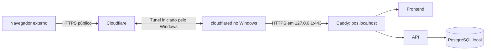

# Publicar o localhost na internet para testes — Windows e Cloudflare Tunnel

Este roteiro descreve o procedimento de acesso pelo navegador confirmado pelo usuário em **27/10/2026**: o POS continua executando em Docker no Windows e recebe uma URL HTTPS temporária na internet por meio de um **Cloudflare Quick Tunnel**.

O guia usa o checkout em `C:\Projects\pos`, o Compose da raiz e o serviço `reverse-proxy`. O instalador Principal usa outro Compose e outro serviço de proxy; seus comandos não devem ser misturados com este roteiro. Para os caixas conectados a um servidor estável, veja [Modo Nuvem](NUVEM.md).

## 1. Resultado e funcionamento

A URL pública abre a mesma aplicação e usa o mesmo banco da instalação local selecionada. Use o ambiente de desenvolvimento com dados sintéticos e usuários de teste. O login e as permissões da aplicação continuam necessários; compartilhe o endereço apenas com as pessoas envolvidas no ensaio.



O computador, Docker e conector precisam permanecer ligados. O túnel dispensa encaminhamento de portas no roteador; banco, Redis e agente de impressão não são destinos do túnel. O único destino deste procedimento é o HTTPS do Caddy. [Funcionamento dos túneis](https://developers.cloudflare.com/tunnel/concepts/).

Há duas conexões HTTPS:

| Trecho | Certificado usado | Configuração |
|---|---|---|
| Navegador externo → endereço público | Certificado público servido pela Cloudflare | O visitante usa a URL gerada, sem instalar a CA local. |
| Conector Windows → Caddy local | Certificado emitido pela CA local do Caddy para pos.localhost | O conector recebe root.crt e o nome esperado; mantém a verificação TLS. |

A CA copiada é pública. Não copie chaves privadas do volume do Caddy nem distribua arquivos de credenciais. Este roteiro usa `--origin-ca-pool` e `--origin-server-name` para a origem HTTPS. [Parâmetros oficiais da origem](https://developers.cloudflare.com/cloudflare-one/networks/connectors/cloudflare-tunnel/configure-tunnels/origin-parameters/).

## 2. Preparação e regra de cópia dos comandos

Você precisa de Windows, PowerShell, Docker Desktop funcionando com containers Linux, o checkout já configurado e o login de teste do POS. Este guia parte de uma aplicação local existente; em um ambiente novo, siga primeiro o Quickstart do README para gerar as credenciais e construir as imagens.

Todos os blocos PowerShell abaixo contêm **um único comando em uma linha**. Copie somente o conteúdo do bloco, pressione Enter e aguarde terminar antes do próximo. Não copie o prefixo `PS C:\...>`, não execute caminhos .crt isoladamente e não acrescente uma atribuição de variável ao fim de um comando Docker. Uma quebra visual da linha longa na tela não exige pressionar Enter no meio dela.

Abra duas janelas:

- **Janela A — túnel:** prepara o acesso local e depois permanece ocupada com cloudflared.
- **Janela B — API e verificações:** recebe a URL da Janela A, configura as origens e executa os testes/encerramento.

Os comandos Docker usam `-f` com o caminho absoluto do Compose para funcionarem mesmo quando o PowerShell abre em `C:\Windows\System32`. Caso o checkout esteja em outro diretório, ajuste todos os caminhos `C:\Projects\pos` deste guia.

## 3. Janela A: conferir o projeto e iniciar os serviços

Entre na pasta do projeto:

```powershell
Set-Location -LiteralPath 'C:\Projects\pos'
```

Confira se o arquivo correto existe. O resultado precisa ser `True`:

```powershell
Test-Path -LiteralPath 'C:\Projects\pos\docker-compose.yml'
```

Confira se o Docker responde. Para este projeto, o resultado esperado é `linux`:

```powershell
docker info --format '{{.OSType}}'
```

Inicie os serviços existentes:

```powershell
docker compose -f 'C:\Projects\pos\docker-compose.yml' up -d
```

Confira também os containers parados:

```powershell
docker compose -f 'C:\Projects\pos\docker-compose.yml' ps --all
```

Você deve encontrar `db`, `redis`, `api`, `frontend` e `reverse-proxy` em execução. A API pode levar alguns segundos para concluir o início. Os serviços que possuem healthcheck devem chegar a `healthy`; nem todos os serviços deste Compose possuem esse campo.

Se as imagens ainda não foram construídas ou você precisa publicar mudanças recentes de código, use `docker compose -f 'C:\Projects\pos\docker-compose.yml' up -d --build` em uma preparação local planejada, antes de abrir o túnel. Recriar um container sem build não incorpora mudanças de código na imagem.

**Atenção à dependência dos comandos:** `--no-deps` será usado depois para recriar somente a API. Ele pressupõe que banco, Redis, frontend e proxy já estejam funcionando. Não substitui esta etapa de inicialização.

## 4. Janela A: exportar a CA pública do Caddy

Crie a pasta de artefatos, caso ainda não exista:

```powershell
New-Item -ItemType Directory -Path 'C:\Projects\pos\artifacts' -Force | Out-Null
```

Copie a CA com este comando inteiro, em uma linha:

```powershell
docker compose -f 'C:\Projects\pos\docker-compose.yml' cp 'reverse-proxy:/data/caddy/pki/authorities/local/root.crt' 'C:\Projects\pos\artifacts\tunnel-caddy-root.crt'
```

Aguarde a confirmação de cópia. Confira o arquivo:

```powershell
Test-Path -LiteralPath 'C:\Projects\pos\artifacts\tunnel-caddy-root.crt'
```

O resultado esperado é `True`. O .crt é um arquivo de certificado usado como argumento do conector, não um comando PowerShell. Esta etapa não importa certificados no Windows. A pasta `artifacts` já é ignorada pelo Git.

Se aparecer que o arquivo de origem ainda não existe, confirme que o Caddy iniciou e atende `pos.localhost`. Confira seus logs, aguarde a emissão local e repita a cópia. Se a CA da instalação for recriada, exporte novamente o arquivo e reinicie o túnel com a cópia atual.

## 5. Janela A: validar o HTTPS local

Use `curl.exe` explicitamente, pois `curl` pode ser um alias de outro comando no PowerShell. Este teste usa o arquivo de CA e resolve pos.localhost para loopback sem alterar o arquivo hosts:

```powershell
curl.exe --fail --silent --show-error --max-time 15 --cacert 'C:\Projects\pos\artifacts\tunnel-caddy-root.crt' --resolve 'pos.localhost:443:127.0.0.1' 'https://pos.localhost/api/v1/health'
```

O esperado é uma resposta JSON como:

```json
{"status":"ok","time":"<data retornada pelo banco>"}
```

Esse endpoint consulta PostgreSQL: uma resposta bem-sucedida confirma Caddy, API e banco nesse caminho. Se falhar, resolva o acesso local antes de abrir o túnel, seguindo a seção de problemas comuns.

O navegador local pode precisar da confiança da CA descrita em [USO.md](USO.md) e no README. Essa confiança local do navegador é independente da conexão do visitante com a URL pública.

## 6. Janela A: instalar/conferir cloudflared e abrir o túnel

Instale a versão Windows pelo [download oficial de cloudflared](https://developers.cloudflare.com/cloudflare-one/networks/connectors/cloudflare-tunnel/downloads/). Se você usa o instalador Windows, conclua a instalação e abra uma nova janela PowerShell para atualizar o PATH. Se baixou somente o executável, use seu caminho completo.

Confira a versão:

```powershell
cloudflared --version
```

Se o comando não for encontrado e a instalação estiver no caminho observado neste ensaio, confira pelo caminho completo:

```powershell
& 'C:\Program Files (x86)\cloudflared\cloudflared.exe' --version
```

O caractere `&` manda o PowerShell executar um programa cujo caminho está entre aspas. Se o arquivo estiver em outro local, ajuste o caminho.

Abra o túnel com **esta linha inteira**:

```powershell
cloudflared tunnel --url https://127.0.0.1:443 --http-host-header pos.localhost --origin-server-name pos.localhost --origin-ca-pool 'C:\Projects\pos\artifacts\tunnel-caddy-root.crt'
```

Alternativa equivalente, quando o programa não está no PATH e está instalado no caminho acima — escolha somente uma delas:

```powershell
& 'C:\Program Files (x86)\cloudflared\cloudflared.exe' tunnel --url https://127.0.0.1:443 --http-host-header pos.localhost --origin-server-name pos.localhost --origin-ca-pool 'C:\Projects\pos\artifacts\tunnel-caddy-root.crt'
```

Os parâmetros são específicos do Caddy deste projeto:

| Parâmetro | Finalidade |
|---|---|
| --url https://127.0.0.1:443 | Acessar a porta HTTPS publicada localmente pelo Docker. |
| --http-host-header pos.localhost | Selecionar o site configurado no Caddy. |
| --origin-server-name pos.localhost | Exigir o nome coberto pelo certificado da origem local. |
| --origin-ca-pool caminho.crt | Usar a CA pública exportada para validar a origem. |

Mantenha a Janela A aberta. Nos logs aparecerá uma URL como `https://seu-endereco.trycloudflare.com`. Copie **a URL real gerada**, sem acrescentar caminhos. O endereço deste exemplo é apenas ilustrativo. O Quick Tunnel não exige conta ou domínio próprio. [Quick Tunnels](https://developers.cloudflare.com/tunnel/get-started/quick-tunnels/).

## 7. Janela B: permitir a origem pública na API

Abra a segunda janela e entre no projeto:

```powershell
Set-Location -LiteralPath 'C:\Projects\pos'
```

Defina a URL recebida da Janela A. **Substitua o exemplo antes de executar**, mantendo HTTPS e sem barra final:

```powershell
$posPublicUrl = 'https://seu-endereco.trycloudflare.com'
```

Defina a lista de origens permitidas. Execute esta atribuição primeiro, sozinha:

```powershell
$env:CORS_ALLOWED_ORIGINS = "https://pos.localhost,$posPublicUrl"
```

O exemplo preserva o acesso local padrão. Caso seu ambiente já use outras origens autorizadas, mantenha-as nessa lista, separadas por vírgulas. A variável pertence a esta janela PowerShell; o comando Docker seguinte precisa ser executado **nela mesma**. Não é preciso editar .env para este teste temporário.

Agora execute o comando Docker separadamente:

```powershell
docker compose -f 'C:\Projects\pos\docker-compose.yml' up -d --no-deps --force-recreate api
```

Isso recria a API com o valor resolvido pelo Compose. Há uma breve interrupção da API durante a recriação. O processo não remove volumes ou dados do banco. Não use remoção de volumes para corrigir problemas deste roteiro.

Confira somente a variável de origens do container, sem listar seu ambiente completo:

```powershell
docker compose -f 'C:\Projects\pos\docker-compose.yml' exec -T api printenv CORS_ALLOWED_ORIGINS
```

A saída deve conter `https://pos.localhost` e a URL real do seu túnel. Fechar a Janela B não altera um container já criado; a configuração permanece nele até uma nova recriação. Um comando Compose executado posteriormente em outra janela pode voltar ao valor de .env/padrão, por isso confira a origem após novas recriações.

A variável configura a lista CORS da API. Ela não cria o túnel, não substitui autenticação e não restringe, por si só, quem consegue visitar a URL pública.

## 8. Janela B: testar o acesso externo

Aguarde a API iniciar e execute:

```powershell
curl.exe --fail --silent --show-error --max-time 15 "$posPublicUrl/api/v1/health"
```

Espere `status: ok`. A validação dessa conexão usa o certificado público, sem fornecer a CA do Caddy. Para conferir o cabeçalho CORS, faça uma requisição com Origin explícita:

```powershell
curl.exe --silent --show-error --max-time 15 --dump-header - --output NUL --header "Origin: $posPublicUrl" "$posPublicUrl/api/v1/health"
```

Confira HTTP 200 e `Access-Control-Allow-Origin` correspondente à URL informada. Depois:

1. No celular, desligue o Wi-Fi e use dados móveis, ou use outro computador fora da rede local.
2. Abra a URL pública real no navegador e entre com um usuário de teste autorizado.
3. Confira a navegação, consultas e uma operação sintética apropriada às permissões do usuário.
4. Confira o mesmo registro no acesso local: o túnel usa a mesma aplicação e banco.
5. Mantenha o conector e os serviços locais em execução durante o ensaio.

Não compartilhe a senha do administrador no endereço, em capturas ou nos logs. O endereço público não é uma credencial de acesso.

## 9. Repetir o teste em outro dia

O hostname do Quick Tunnel muda quando um novo túnel é criado. Repita a abertura na Janela A, obtenha a nova URL e repita a definição de `$posPublicUrl`, da lista CORS e a recriação da API na Janela B. Os links antigos deixam de servir para esse novo túnel. [Ciclo de vida e limitações](https://developers.cloudflare.com/tunnel/get-started/quick-tunnels/).

Não é necessário gerar outra CA a cada abertura: reutilize a cópia enquanto ela corresponder à mesma instalação do Caddy. Certificado da origem vencido exige revisar relógio, renovação e logs do Caddy; certificado/CA de outra instalação exige nova exportação.

## 10. Encerrar o acesso público e restaurar a configuração local

1. Na **Janela A**, pressione **Ctrl+C** e aguarde cloudflared encerrar. Isso encerra o túnel; a aplicação local pode continuar funcionando.
2. Na **Janela B**, remova a variável temporária do processo:

```powershell
Remove-Item Env:CORS_ALLOWED_ORIGINS -ErrorAction SilentlyContinue
```

3. Na mesma janela, recrie a API para usar novamente o valor de .env/padrão do Compose:

```powershell
docker compose -f 'C:\Projects\pos\docker-compose.yml' up -d --no-deps --force-recreate api
```

4. Confira o valor efetivo novamente:

```powershell
docker compose -f 'C:\Projects\pos\docker-compose.yml' exec -T api printenv CORS_ALLOWED_ORIGINS
```

Se você alterou .env manualmente, restaure também a lista original antes de recriar. Encerrar o túnel e restaurar CORS são ações distintas: CORS não encerra a publicação. Este procedimento de encerramento mantém a aplicação local e os volumes.

## 11. Problemas comuns e recuperação

### O PowerShell tenta executar o arquivo .crt ou o texto reverse-proxy:/...

Sintomas observados: `The term '.\artifacts\tunnel-caddy-root.crt' is not recognized` ou erro equivalente para `reverse-proxy:/data/...`.

Os argumentos foram executados em separado. Repita o comando completo de cópia da etapa 4, em uma linha. O arquivo de certificado e o caminho dentro do container são argumentos de `docker compose cp`, não programas. Não use continuação com crase neste roteiro.

### Docker: no configuration file provided: not found

O Docker não encontrou o Compose na pasta atual. Confira `Test-Path` e use os comandos deste guia com `-f 'C:\Projects\pos\docker-compose.yml'`. Estar em `C:\Windows\System32` não faz o Docker encontrar o projeto automaticamente.

### Docker: no such service: =

A atribuição foi anexada ao comando Docker e o sinal `=` foi interpretado como nome de serviço. Execute **a atribuição de CORS primeiro** e, depois, **o comando de recriação da API**, cada um em sua linha, na mesma janela. Não acrescente `$env:CORS_ALLOWED_ORIGINS = ...` ao fim de `docker compose ... api`.

### cloudflared não é reconhecido

Reabra o PowerShell após instalar, confira `cloudflared --version` ou use a alternativa com caminho completo e `&` da etapa 6. As aspas delimitam o caminho; sozinhas não executam o programa. Não instale um serviço Windows apenas para esse ensaio temporário.

### Erro de certificado, autoridade desconhecida ou nome divergente

Confirme o arquivo de CA, `--origin-server-name pos.localhost` e `--http-host-header pos.localhost`. Use a CA da mesma instalação que atende a porta 443 e confira o relógio. Se o Caddy foi recriado com outra CA, repita a exportação. Preserve a verificação TLS durante o diagnóstico.

### Erro 502 / Bad Gateway ou conexão recusada em localhost:443

Confira primeiro os serviços:

```powershell
docker compose -f 'C:\Projects\pos\docker-compose.yml' ps --all
```

Se os containers **existem e estão parados**, inicie-os sem recriá-los:

```powershell
docker compose -f 'C:\Projects\pos\docker-compose.yml' start db redis frontend reverse-proxy
```

Se a API também estiver parada, inicie-a:

```powershell
docker compose -f 'C:\Projects\pos\docker-compose.yml' start api
```

`start` preserva a configuração já gravada nos containers, inclusive CORS. Se os containers ainda não existem, volte à etapa 3 com `up -d` e depois reaplique CORS na Janela B. Aguarde o início e repita o healthcheck local antes do público. A correção de CORS não liga o banco ou o proxy quando foi usado `--no-deps`.

Leia os logs locais necessários:

```powershell
docker compose -f 'C:\Projects\pos\docker-compose.yml' logs --tail 30 api reverse-proxy
```

`getaddrinfo ENOTFOUND db` ou timeout de conexão ao banco, com db parado, indica dependência indisponível. Inicie o banco e aguarde a API tentar novamente. Se persistir, revise a rede/configuração do Compose; não gere novas senhas ou apague volumes por tentativa.

Se o healthcheck local passar e o público ainda falhar, confira a URL atual, o processo cloudflared, seu destino e seus logs. Um túnel conectado à Cloudflare ainda pode não conseguir alcançar o Caddy local.

### Site abre, mas a origem configurada está errada ou a interface está antiga

Confira a variável efetiva com `exec -T api printenv CORS_ALLOWED_ORIGINS`; confirme a atribuição e recriação na mesma janela. A interface e a API usam a origem pública em conjunto. Se as imagens não incluem as mudanças recentes, prepare um build local e retome o roteiro. Alterar somente uma variável não atualiza código de frontend/backend.

### A URL parou após fechar a janela ou reiniciar o computador

Reabra os serviços/conector, copie a nova URL e reaplique a configuração da Janela B. O Quick Tunnel é temporário. Para um endereço estável, use um túnel persistente com domínio configurado.

## 12. Testar o instalador Nuvem e as impressoras

O acesso pelo navegador confirmado neste ensaio não homologa automaticamente pareamento ou saída física de impressão. O Compose de desenvolvimento usa `PRINT_MODE=direct` por padrão e não repassa todas as variáveis exigidas pelo instalador Nuvem. Colocar essas variáveis somente em .env não basta quando não estão mapeadas no Compose.

Antes de conectar um caixa pelo instalador, o servidor de teste precisa ter:

- `STORE_ID` válido e estável, igual ao UUID informado no instalador e respondido em `GET /api/v1/store-info`.
- Frontend com suporte às preferências do Modo Nuvem e migrações existentes aplicadas.
- Para impressão: `PRINT_MODE=queue` e `PRINT_AGENT_TOKEN_SHA256` configurados no ambiente da API. A configuração atual exige esse hash para iniciar o modo queue. Tokens de Terminais são exclusivos e pareados pelo administrador.
- Impressora/driver no Windows do caixa, código de pareamento autorizado e agente executando na conta correta.

Use [NUVEM.md](NUVEM.md) e [IMPRESSORAS.md](IMPRESSORAS.md) para os contratos, pareamento, diagnóstico e reconciliação. Não publique a porta 9222 do agente para viabilizar a impressão externa; o fluxo com fila usa conexões de saída dos agentes.

Para repetir ensaios com o mesmo caixa pareado, prefira uma origem fixa. O cliente instalado fica vinculado a URL/UUID e recusa trocar silenciosamente para uma origem diferente. Não apague POSTerminal ou seus journals para contornar a mudança de URL.

### Evoluir para uma URL de teste fixa

Prepare um túnel persistente com hostname sob um domínio configurado na Cloudflare, seguindo o [guia oficial de configuração](https://developers.cloudflare.com/tunnel/get-started/). Para encaminhar à mesma origem local, os parâmetros correspondentes são:

| Campo da rota | Valor neste projeto |
|---|---|
| Hostname público | Seu subdomínio estável de teste, por exemplo teste.sualoja.com.br |
| Service URL | https://127.0.0.1:443, com o conector no mesmo Windows |
| HTTP Host Header | pos.localhost |
| Origin Server Name | pos.localhost |
| CA Pool | Caminho da CA pública local acessível pelo conector |
| Disable TLS certificate verification | Desativado; manter a validação |

Autorize a nova origem estável em CORS e valide HTTPS/identidade antes do pareamento. A configuração de autenticação adicional do túnel precisa contemplar agentes sem navegador: uma página de login interativa à frente da API não é atendida pelo instalador/worker atual. Este guia não cadastra tokens de túnel ou publica um serviço permanente automaticamente.

## 13. Aceitação do teste e limites

Registre a versão do checkout, data, responsável e URL da sessão. Confirme:

- [ ] API e banco respondem no healthcheck local com validação da CA.
- [ ] URL pública responde por HTTPS e o login funciona fora da rede da loja.
- [ ] Origem pública efetiva aparece na configuração da API.
- [ ] Operações sintéticas são vistas no acesso local e externo.
- [ ] Fechar cloudflared encerra o acesso por esse túnel; o acesso local continua.
- [ ] CORS foi restaurado e conferido ao final.
- [ ] Se houver ensaio de impressão, destino, conta Windows, fila, papel e journal foram conferidos separadamente.

Quick Tunnels servem para desenvolvimento, não têm garantia de disponibilidade, limitam requisições simultâneas em andamento a 200 e não suportam SSE. Use o ensaio para validar acesso funcional, sem tratá-lo como benchmark de produção. [Limitações oficiais](https://developers.cloudflare.com/tunnel/get-started/quick-tunnels/).

O roteiro não exige novas migrações ou alterações de seed, nem instalar certificados nos dispositivos externos. A API continua aplicando as migrações da versão da imagem durante sua inicialização normal. Credenciais, volumes, backups, permissões e regras de negócio da aplicação permanecem sob os procedimentos do projeto. Publicação permanente e operação de várias lojas exigem a implantação descrita no planejamento de Nuvem.

## Referências

- [Cloudflare: Quick Tunnels](https://developers.cloudflare.com/tunnel/get-started/quick-tunnels/).
- [Cloudflare: funcionamento dos túneis](https://developers.cloudflare.com/tunnel/concepts/).
- [Cloudflare: origem HTTPS, Host e CA Pool](https://developers.cloudflare.com/cloudflare-one/networks/connectors/cloudflare-tunnel/configure-tunnels/origin-parameters/).
- [Cloudflare: download do conector Windows](https://developers.cloudflare.com/cloudflare-one/networks/connectors/cloudflare-tunnel/downloads/).
- [Cloudflare: configuração de túnel persistente](https://developers.cloudflare.com/tunnel/get-started/).
- [Projeto: Modo Nuvem](NUVEM.md), [uso local](USO.md), [documentação técnica](TECNICO.md) e [homologação](HOMOLOGACAO.md).
