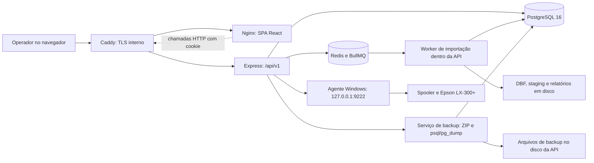
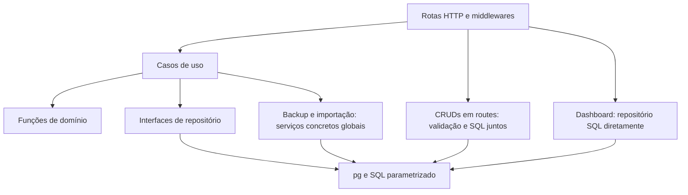
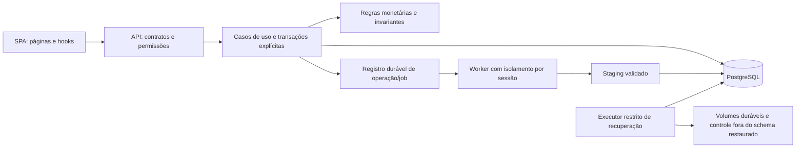

# Diagnóstico arquitetural

> Retrato da base anterior à implementação. Decisões de contexto e controles entregues posteriormente: [registro da fase zero](06-contexto-e-fase-zero.md).

Data de referência: **21/10/2026**, America/Sao_Paulo. Escopo: estado de trabalho de `C:\Projects\pos`, incluindo alterações locais e arquivos ainda não versionados. HEAD de referência: `ac85924e7a94e836805e770c60db8141c783bca6`. As referências de linhas correspondem a esse estado, e não necessariamente ao HEAD.

Documentos relacionados: [inventário e evidências](02-inventario-problemas.md), [backlog executável](03-backlog-tecnico.md), [roadmap](04-roadmap-implementacao.md), [resumo executivo](05-resumo-executivo.md).

## 1. Parecer

O sistema tem uma base adequada para um PDV de pequeno ou médio porte: monólito modular, PostgreSQL, uma SPA e integração local de impressão. Não há evidência que justifique substituir essa arquitetura por microsserviços. Há controles úteis de autenticação, validação, transações e observabilidade, mas a recuperação de dados, a importação legada e algumas invariantes financeiras ainda não oferecem segurança operacional suficiente.

Os bloqueadores mais importantes são segredos versionados, infraestrutura incompleta de backup, restauração sem coordenação das escritas e importação que confirma a exclusão dos dados antes de terminar o processamento: [TEC-001–004](02-inventario-problemas.md#tec-001). A prioridade é preservar os dados e estabilizar as regras monetárias; a reorganização de componentes vem depois.

## 2. Método e limites

Foram inventariados os arquivos da aplicação, configurações, SQL, testes, contratos OpenAPI, infraestrutura e documentação operacional. A leitura aprofundada acompanhou autenticação/RBAC, cadastro, checkout, cancelamento, recebimentos, comprovantes, dashboard, backup/restauração, importação DBF e impressão. Os demais componentes de apresentação e CRUD foram examinados por seus padrões de consulta, validação, mutação, permissões e acessibilidade.

O levantamento encontrou **86 arquivos TypeScript no backend, 71 no frontend e um no agente**, incluindo respectivamente 19, nove e zero arquivos de teste. O código TypeScript fora dos testes soma aproximadamente 10.068 linhas no backend, 10.143 no frontend e 127 no agente, contando linhas em branco. CSS, SQL, YAML e documentação foram analisados separadamente. Contagem não equivale a cobertura de testes nem a revisão formal de cada combinação de entradas.

Não foram executados a aplicação de produção, importações reais, restaurações, comandos de migração, arquivos executáveis legados nem impressão física. Não foram abertos os registros pessoais dos DBF/DBT. `demo2/` é uma referência local ignorada pelo Git; seus arquivos não foram tratados como código de produção. Não havia `AGENTS.md` nos diretórios consultados nem na árvore de arquivos localizada.

Limitações materiais:

- O Docker CLI está disponível, mas o daemon Linux não respondeu. Build de imagens, conectividade Docker → impressora, PostgreSQL/Redis reais, planos `EXPLAIN` e recuperação de volumes permanecem sem validação dinâmica.
- O backend não possui `node_modules` nem `package-lock.json` no estado auditado. A resolução instalada temporariamente é uma resolução nova do manifesto, não a identificação das versões de uma implantação existente.
- O frontend instalado localmente não inicia o Vitest porque falta o binário opcional `@rollup/rollup-win32-x64-msvc`. A verificação foi repetida em cópia temporária limpa, usando o lockfile existente.
- Os testes executaram em Windows com Node **24.21.0**, encontrado no runtime local. Produção e CI declaram Node 20; não se presume equivalência integral entre esses ambientes.
- Não houve medição de cobertura percentual, carga HTTP, contraste visual, leitor de tela ou auditoria jurídica de LGPD. Riscos dependentes dessas condições estão identificados como tais.

## 3. Arquitetura reconstruída

O diagrama representa as dependências pretendidas pelo código. A imagem atual da API não instala `psql`/`pg_dump`, não monta armazenamento de backups/importações e roda sem root. A seta para o agente depende da conectividade entre Docker e um serviço restrito ao loopback do host; essa conectividade não foi demonstrada.

A separação em `http/application/domain/repository` está mais desenvolvida em autenticação e vendas. Pagamentos possuem interface de repositório, mas o caso de uso importa `withTransaction` e `PoolClient` de infraestrutura. Cadastro e administração continuam em rotas com SQL. O dashboard chama o repositório diretamente. Essa heterogeneidade é um débito administrável, não motivo para reescrita.

## 4. Módulos, entradas e relações

| Área | Implementação principal | Fluxo e observações |
|---|---|---|
| Inicialização | `backend/src/server.ts:9–18` | Migrações → bootstrap de administrador → inicialização do worker → listener HTTP. Redis é uma dependência efetiva da inicialização, apesar de descrito como opcional no README. |
| HTTP transversal | `backend/src/app.ts:50–83` | Request ID, métricas, Helmet, CORS, JSON, logging, rotas públicas, autenticação global e erro central. |
| Autenticação | `modules/auth`, `middleware/auth.ts` | Bcrypt e JWT; cookie HttpOnly/SameSite=Lax/Secure em produção; permissões e status consultados novamente no banco por requisição. |
| Catálogo | `routes/products.ts`, `customers.ts`, `product-groups.ts`, `sellers.ts`, `payment-terms.ts` | CRUD com Zod e SQL parametrizado. Códigos numéricos de produto/cliente gerados sob advisory lock transacional. |
| Usuários e perfis | `routes/users.ts`, `roles.ts` | RBAC por strings, curinga `*`, desativação lógica do usuário. Leitura e escrita possuem regras parcialmente diferentes da interface. |
| Vendas e estoque | `modules/sales` | Reprecificação pelo catálogo; venda, itens e saídas de estoque em uma transação; cancelamento bloqueia a venda e gera entradas inversas. |
| Recebimentos | `modules/customer-payments` | Bloqueio do cliente para registrar pagamento; saldo calculado por vendas concluídas, valores pagos no checkout e recebimentos avulsos. Não há alocação do recebimento a uma venda. |
| Comprovantes | domínio de vendas e casos de uso de pagamentos | Reimpressão é reconstruída com dados atuais; o comprovante de pagamento não preserva o saldo histórico. |
| Dashboard | `modules/dashboard` | Dez endpoints, CTE compartilhada de filtros, agregações, ranking, curva ABC e posição de estoque por movimentos. |
| Backup | `modules/backup`, `services/backup-restore-service.ts`, `utils/backup.ts` | ZIP com SQL e metadados, checksum SHA-256, simulação em banco temporário, snapshot e tentativa de rollback. Controle fica no mesmo schema restaurado. |
| Importação | `modules/legacy-import`, `services/legacy-import/worker.ts` | Upload → registro no PostgreSQL → BullMQ → extração → staging global → migrações por etapa → reconciliação. |
| Interface | `App.tsx`, `pages`, `components`, `services`, `store` | React Router, React Query para dados remotos, Zustand para autenticação/carrinho e React Hook Form/Zod para formulários. |
| Impressão | `services/print-agent.ts`, `agent/src/index.ts` | HTTP com timeout de 8 s por padrão; agente imprime via PowerShell com timeout de 15 s, sem protocolo de idempotência. |
| Operação | Compose, Dockerfiles, Caddy e CI | Containers sem root para API/frontend; PostgreSQL persistido; sem persistência explícita para Redis, backups ou arquivos de importação. |

### Fluxos críticos

**Checkout:** a SPA calcula uma prévia, a API consulta preços e recalcula a venda, valida o desconto do perfil e insere venda/itens/movimentos na mesma transação. Isso impede confiar em preços adulterados pelo navegador. Porém, preços são lidos antes da transação de gravação e não há cotação/versionamento apresentado ao operador quando o catálogo muda. Essa é uma decisão de negócio pendente, não uma vulnerabilidade comprovada. Arredondamento, pagamento incompleto e repetição de requisições possuem defeitos independentes, registrados em TEC-013, TEC-015 e TEC-016.

**Recebimento e cancelamento:** pagamentos bloqueiam `customer`; cancelamentos bloqueiam apenas `sale`. As operações leem agregados e podem aprovar, simultaneamente, alterações que violam o saldo. Recebimentos são globais por cliente; por isso `sale.pending_amount` representa o saldo original após o checkout, sem descontar recebimentos avulsos. A interface deve explicitar essa semântica ou adotar alocação aprovada pelo negócio, evitando simplesmente mudar a fórmula por venda.

**Importação:** checkpoints e transação por etapa ajudam a retomar a mesma sessão. Não asseguram atomicidade da substituição completa, deduplicação entre sessões nem isolamento entre workers/processos. `overwrite=false` ainda faz upsert de cadastros e vendas; pagamentos e movimentos são inseridos novamente. `overwrite=true` limpa também dados operacionais sem distinguir sua origem.

**Recuperação:** a simulação cria outro banco, mas executa o SQL no mesmo host PostgreSQL e com as mesmas credenciais. Não constitui isolamento de segurança para um arquivo SQL não confiável. A restauração principal remove o schema em uma chamada e o recria/importa em outras, enquanto a API continua aceitando operações.

## 5. Tecnologias e dependências

| Camada | Tecnologias e versões verificáveis |
|---|---|
| API | Node 20.18.3 na imagem, Express `^4.19.2`, TypeScript `^5.6.3`, pg `^8.12.0`, Zod `^3.23.8`, JWT `^9.0.2`, bcryptjs `^2.4.3`. São intervalos do manifesto; falta lockfile do backend. |
| Processamento | BullMQ `^5.61.0`, ioredis `^5.8.2`, dbffile `^1.12.0`, extract-zip `^2.0.1`, archiver `^6.0.2`, multer `^1.4.5-lts.1`. |
| SPA | React 18, React Query 5, Zustand 4, React Hook Form 7, i18next 23, React Router DOM **6.30.1**, Vite **5.4.21**, Vitest **2.1.9** no lockfile. |
| Infraestrutura | PostgreSQL 16, Redis 7, Caddy 2, Nginx unprivileged 1.27.3; tags não identificam o digest implantado. |
| Qualidade | Vitest, Supertest, tsc strict, ESLint 8 e Prettier. ESLint configura o parser, mas não habilita regras. |

Na data da auditoria, Node 20 está fora de suporte; Node 22 e 24 constam como LTS. A atualização deve alinhar desenvolvimento, CI e containers, escolhendo uma linha suportada após validar compatibilidade. [Calendário oficial do Node.js](https://github.com/nodejs/Release#release-schedule).

### Resultado da consulta de vulnerabilidades

`npm audit --json --ignore-scripts`, executado nas cópias temporárias, retornou:

| Base consultada | Total de entradas de pacote | Críticas | Altas | Moderadas | Baixas |
|---|---:|---:|---:|---:|---:|
| Backend: resolução nova do manifesto | 7 | 2 | 2 | 3 | 0 |
| Frontend: lockfile existente | 18 | 2 | 11 | 4 | 1 |
| Agente: lockfile local ainda não versionado | 4 | 1 | 0 | 3 | 0 |

Esses totais incluem dependências de desenvolvimento e propagação de um mesmo aviso pela árvore; **não representam 29 explorações independentes nem prova de comprometimento**. O relatório do registro não listou Multer, embora a resolução resulte em `1.4.5-lts.2`, abrangida por aviso publicado pelo próprio projeto. A ausência no `npm audit` não foi interpretada como segurança.

Repetindo a consulta com `--omit=dev`, o registro retornou uma entrada alta no backend (`extract-zip`), três altas no frontend (a cadeia `react-router-dom`/`react-router`/`@remix-run/router`) e quatro no agente (uma crítica e três moderadas). A entrada crítica do agente envolve `proxy-addr`; o código atual não configura confiança em proxies, portanto esse resultado requer triagem de alcance, não afirmação de exploração. O lockfile identifica pacotes distribuídos, mas não prova que todos os caminhos vulneráveis da biblioteca são usados pela SPA.

`morgan`, `@types/morgan` e `iconv-lite` estão declarados em `backend/package.json:23,33,42`, sem imports encontrados em `backend/src` ou `backend/scripts`. São candidatos a remoção dentro de TSK-007, após validar scripts/consumidores externos; não foram removidos nesta etapa.

Casos relevantes para o código:

- `extract-zip 2.0.1` é chamado com ZIPs enviados por usuários. Há avisos de symlinks/escape de diretório, sem versão corrigida informada na consulta. O risco é aplicável às rotas administrativas, após autenticação e permissão; não foi enviado ZIP malicioso. [Relato original](https://github.com/ziad626/extract-zip-security-research/security/advisories/GHSA-x7jf-2287-qcpf), [correção discutida no repositório](https://github.com/max-mapper/extract-zip/pull/160).
- O intervalo Multer 1.x mantém o projeto em uma linha afetada por DoS de multipart. Como `requirePermission` precede o upload, o atacante precisa de acesso autorizado à rota neste sistema. Atualizar para uma versão 2.x corrigida na data da implementação, cobrindo também avisos posteriores. [Aviso oficial do Multer](https://github.com/expressjs/multer/security/advisories/GHSA-4pg4-qvpc-4q3h), [avisos atuais](https://github.com/expressjs/multer/security/advisories).
- Vite 5.4.21 e `server.host=true` exigem revisão do servidor de desenvolvimento em Windows. Produção usa Nginx e arquivos estáticos; não se atribui a ela a exploração do dev server. [Aviso oficial do Vite](https://github.com/vitejs/vite/security/advisories/GHSA-fx2h-pf6j-xcff).
- O aviso crítico de Vitest exige condições como UI/API ou Browser Mode. Os scripts auditados usam `vitest run`; o aviso não demonstra RCE no POS em produção. [Aviso oficial do Vitest](https://github.com/vitest-dev/vitest/security/advisories/GHSA-5xrq-8626-4rwp).

## 6. Pontos fortes e princípios de engenharia

- API de vendas recalcula preços no servidor e aplica desconto por perfil: `sales-use-cases.ts:42–105`.
- Escritas de venda, itens e movimentos usam o mesmo `PoolClient`: `sales-repository.ts:235–303`. O cancelamento bloqueia a venda, impedindo duas reversões da mesma venda no caminho normal.
- SQL de entradas usa parâmetros; os identificadores interpolados em CRUDs são obtidos de schemas Zod ou listas internas, e não diretamente de campos arbitrários do cliente.
- Status e permissões do usuário são consultados no banco por requisição, permitindo aplicar desativação e mudanças de perfil sem esperar o JWT expirar.
- Há validação central de ambiente, CORS com allowlist, Helmet, tratamento central de erros e cookie HttpOnly.
- Repositórios e funções puras permitem testar regras de venda sem banco. Os testes existentes executaram com sucesso.
- Paginação no backend, índices trigram e página de vendas antes do agregado de itens evitam vários problemas clássicos de listagem. Não foi identificado N+1 de leitura na listagem de vendas; há roundtrips de escrita por item.
- Modal e toast já possuem recursos de acessibilidade, e existem estados de carregamento/erro em várias páginas. O problema é completar e testar esses recursos.

**SOLID:** separação e inversão de dependência são parciais; não há benefício demonstrado em criar interfaces para cada CRUD trivial. **DRY:** existe repetição concreta nos três CRUDs simples e seus formulários, nos conversores numéricos e nas chaves de cache. **KISS/YAGNI:** manter o monólito e extrair pequenas responsabilidades é mais apropriado que introduzir barramento de eventos, CQRS geral ou múltiplos serviços.

A inspeção de imports relativos encontrou uma referência circular **de tipos** entre contratos e domínio de pagamentos (`customer-payments-contracts.ts` importa o parser do domínio; o domínio importa `PaymentListQueryDto` com `import type`). Esse resultado não é um ciclo de execução. Não foi identificado outro ciclo no grafo inspecionado. A análise usou resolução de imports locais; não prova ausência de ciclos dinâmicos em bibliotecas.

## 7. Segurança por superfície

Referencial de categorias: [OWASP Top 10:2025](https://top10.owasp.org/2025/). O mapeamento organiza riscos e não certifica conformidade.

| Superfície | Resultado |
|---|---|
| Controle de acesso | Autenticação global e permissões nas rotas. Escopo é global por loja/banco; não há evidência de requisito multitenant ou de isolamento por vendedor. Não declarar IDOR apenas porque um usuário pode consultar UUIDs. |
| Identidade e sessão | Sem limitação de tentativas na aplicação; JWT não é revogado por logout/troca de senha. Há proteção por cookie, expiração e checagem de usuário ativo. TEC-021/022. |
| Segredos e privacidade | `.env` e `backend/.env` permanecem rastreados, apesar do `.gitignore`. DBF/DBT e arquivo de senha legado também estão rastreados; autenticidade/sensibilidade precisam de classificação. Não foram copiados valores para esta auditoria. TEC-001. |
| Injeção/XSS | Não foi localizado uso de `dangerouslySetInnerHTML`, `eval` ou SQL que concatene diretamente valores de usuário nas rotas examinadas. Há risco específico de executar SQL/metacomandos de backup com credenciais privilegiadas; simulação não o neutraliza. TEC-003. |
| CSRF | Cookie Lax e requisições JSON com CORS reduzem a superfície. Não existe validação explícita de Origin/token CSRF. Exploração não foi comprovada; validar origens de mesmo site, métodos e tipos de conteúdo em testes de navegador antes de declarar vulnerabilidade. |
| SSRF | URL de impressão vem de configuração, não do corpo de uma requisição. Nenhum SSRF controlado por usuário foi demonstrado. Revisar allowlist/protocolo ao definir topologia de impressão. |
| Arquivos | Limites de upload comprimido existem, mas não há orçamento descomprimido nem política de symlinks. Há caminhos de erro que deixam uploads temporários. TEC-006. |
| Disponibilidade | Cardinalidade de métricas cresce com caminhos arbitrários, sem limitação de requisições; SQL sem timeout explícito e intervalo de dashboard sem teto. TEC-025/033. |
| Auditoria | Backup/importação têm trilha; vendas, cancelamentos e alterações de usuários/perfis não usam `logAudit`. Logs incluem URL de busca e erro sob chave que não corresponde à redação configurada. TEC-026. |

## 8. Evidência de validação

As verificações foram feitas sobre uma cópia em `%TEMP%/pos-technical-audit-*`, sem copiar `.env` ou os dados legados. A instalação usou `--ignore-scripts`. Frontend: `npm ci`; backend: `npm install`, porque o lockfile está ausente. npm 12.2.0 foi obtido do registro oficial e teve sua integridade verificada. Nenhum pacote foi instalado no repositório original.

| Verificação | Resultado |
|---|---|
| Frontend original: `tsc --noEmit -p tsconfig.json` | Passou. |
| Frontend original: Vitest | Não iniciou: módulo nativo do Rollup ausente. |
| Frontend isolado: Vitest 2.1.9, `run --maxWorkers=2 --minWorkers=1` | **9 arquivos / 28 testes passaram**. |
| Backend isolado: mesmo comando Vitest | **19 arquivos / 60 testes passaram**. |
| Backend isolado: lint, typecheck e build tsc | Passaram; lint não possui regras habilitadas. |
| Frontend isolado: lint, typecheck e `vite build` | Passaram; bundle principal **526,53 kB**, gzip **146,39 kB**, com aviso de chunk acima de 500 kB. |
| Verificações adicionais de funções reais compiladas | Reproduziram divergência de arredondamento, aceitação de precisão incompatível com SQL e checkout sem pagamento. |
| Docker / banco / Redis / impressora | Não validados dinamicamente; daemon Docker indisponível. |

### Reproduções adicionais, sem banco

1. `buildCatalogPricedItems` recebe dois produtos distintos com preço `0.01` e quantidade `0.5` cada. Retorna dois itens com `total=0.01`. `computeSaleTotals` retorna `subtotal=total=0.01`, embora a soma dos itens seja `0.02`. A prévia do frontend soma os totais arredondados e mostra `0.02`. **TEC-013**.
2. `createSaleSchema.parse` aceita `quantity=0.0001`; `paymentInputSchema.parse` aceita `amount=0.001`. As colunas SQL são `numeric(14,3)` e `numeric(14,2)`, respectivamente. A aceitação foi executada; o efeito de arredondamento/check no PostgreSQL foi inferido do schema e deve ser validado em banco descartável. **TEC-013**.
3. `createCreateSaleUseCase`, com catálogo simulado de R$ 100 e um item, aceita payload sem pagamento/cliente e encaminha ao repositório `total=100`, `amountPaid=null`, `paymentMethod=null`, `customerId=null`, `pendingAmount=100`. O repositório grava `status='completed'`. Não houve inserção real. **TEC-016**.

Os testes nomeados `integration` usam Express/Supertest com banco mockado. `worker.phase5.test.ts` cobre reenfileiramento e ID de job, mas não executa migração DBF; o teste de recuperação substitui ZIP/SQL/banco por mocks. O teste `i18n.visual` inspeciona traduções, não pixels. Testes verdes, portanto, não comprovam concorrência, SQL ou recuperação reais.

O benchmark histórico em `docs/performance/phase4-benchmark.md` é documentação anterior, não medição desta auditoria. Seu script `backend/sql/benchmarks/phase4_before_after.sql:239–243` calcula throughput pelo inverso da latência SQL média, sem tráfego HTTP concorrente; os valores em “req/s” não demonstram a capacidade HTTP do POS. O script ainda remove/recria índices e só pode ser reutilizado em banco descartável. A reprodução do parser numérico real também confirmou `abc → 0` e `1e3 → 13` (TEC-035).

## 9. Arquitetura futura recomendada

Manter SPA, API e PostgreSQL. Evoluir por cortes pequenos:

1. Tornar armazenamento e recuperação operáveis; estabelecer fronteira de confiança de backups e modo de manutenção coordenado com todas as escritas e o worker.
2. Definir política monetária única, pagamento aplicado líquido de troco, bloqueio por cliente e idempotência persistente.
3. Isolar staging por sessão ou serializar globalmente a importação; separar preparação, validação e publicação. Persistir os arquivos antes de prometer durabilidade de jobs.
4. Consolidar chaves de consulta e invalidadores por entidade; limpar cache/carrinho em troca de usuário; adotar paginação visível e relatórios completos.
5. Extrair do worker parsing, persistência por domínio, reconciliação e orquestração. Separar grandes páginas em hooks e seções seguindo os componentes já existentes de cliente.
6. Implantar testes reais de SQL/concorrência e smoke tests de imagens, depois regras úteis de lint e verificações de contratos. Acrescentar budgets de desempenho medidos antes de cache/materialização.

O executor de recuperação pode começar como rotina operacional isolada; um serviço independente só se justifica caso os requisitos operacionais o exijam. Não se propõe migração tecnológica como pré-requisito para corrigir os defeitos.

## 10. Questões que exigem validação de contexto

| Questão | Evidência / ação proposta |
|---|---|
| Segredos versionados são usados em ambiente ativo? | Inspecionar inventário de implantação e rotacionar onde houver correspondência, sem publicar valores. Não há prova de acesso externo indevido. |
| DBFs são dados reais ou fixtures autorizadas? | Classificar origem, necessidade e acesso; substituir por fixtures sintéticas se necessário. Não inferir conformidade LGPD pelo código. |
| Limite de crédito e cliente inativo devem bloquear venda? | Campos existem em `customer`; checkout não os consulta. Registrar decisão antes de adicionar bloqueio que altere regra de negócio. |
| Cancelamento deve permitir crédito/reembolso? | Hoje a API bloqueia crédito e sugere estornar recebimentos, mas não há endpoint de estorno correspondente. Definir fluxo contábil e autorização antes de criá-lo. |
| Estoque negativo é permitido? | Movimentos são registrados, sem reserva/checagem de disponibilidade. Não impor política de estoque sem confirmação do negócio. |
| Como tratar cancelamento de vendas anteriores à introdução dos movimentos? | A migração `20260624_001_sale_stock_movements.sql` não faz backfill; cancelar sempre cria entrada. Reconciliar amostra histórica com a origem dos movimentos antes de corrigir. |
| Qual custo/margem e data devem compor KPIs? | Há fallback de preço de venda como custo, datas de pagamento presumidas e receita por item antes do desconto. Aprovar fórmulas e rotular limitações. |
| Qual máquina imprime cada venda? | API tem URL única e agente escuta loopback. Validar topologia real com infraestrutura e operadores; não abrir a porta indiscriminadamente. |

Essas validações estão incorporadas às tarefas correspondentes. Não são pré-requisitos para iniciar a contenção de segredos, garantir backups ou reproduzir os defeitos monetários já demonstrados.
