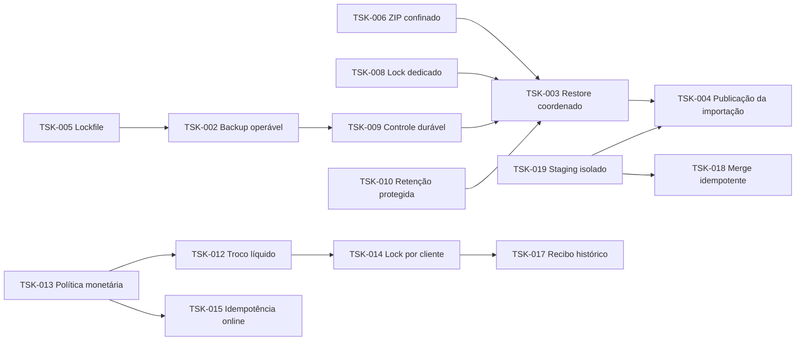

# Backlog técnico priorizado

Data: **21/10/2026**. Origem: [inventário](02-inventario-problemas.md). Sequência e gates: [roadmap](04-roadmap-implementacao.md). Arquitetura e limites de evidência: [diagnóstico](01-diagnostico-arquitetural.md).

Cada tarefa corresponde ao achado TEC de mesmo número. A relação é explícita para permitir abrir issues sem refazer a investigação. Estimativas em pontos relativos: **1** alteração pequena/local; **2–3** alteração localizada com integração; **5** mudança transversal; **8** mudança ampla que deve ser repartida em entregas verificáveis. Baixo/médio/alto é a classificação de esforço do inventário; pontos não são horas ou dias e não medem a capacidade de uma equipe específica.

A soma inicial é **153 pontos**, sujeita a reestimativa após a equipe calibrar a escala e esclarecer as decisões de negócio. P0 pode exigir uma tarefa P1 pequena como pré-requisito; isso não reduz a urgência do risco. A auditoria original não implementou mudanças. Posteriormente, o usuário autorizou a fase 0; ver [execução e decisões confirmadas](06-contexto-e-fase-zero.md). Os itens abaixo preservam a descrição do problema na base auditada.

## Épicos

| Épico | Objetivo | Tarefas |
|---|---|---|
| E1 — Segurança e recuperação | Proteger dados, segredos e recuperação. | [TSK-001](#tsk-001), [TSK-002](#tsk-002), [TSK-003](#tsk-003), [TSK-006](#tsk-006), [TSK-008](#tsk-008), [TSK-009](#tsk-009), [TSK-010](#tsk-010) |
| E2 — Importação confiável | Importar de forma isolada, repetível e recuperável. | [TSK-004](#tsk-004), [TSK-018](#tsk-018), [TSK-019](#tsk-019), [TSK-020](#tsk-020) |
| E3 — Base de entrega e qualidade | Reproduzir builds e detectar regressões. | [TSK-005](#tsk-005), [TSK-007](#tsk-007), [TSK-027](#tsk-027), [TSK-028](#tsk-028) |
| E4 — Fluxos e interface confiáveis | Tornar os fluxos visíveis confiáveis e acessíveis. | [TSK-011](#tsk-011), [TSK-023](#tsk-023), [TSK-024](#tsk-024), [TSK-030](#tsk-030), [TSK-036](#tsk-036) |
| E5 — Integridade financeira | Garantir invariantes financeiras e históricas. | [TSK-012](#tsk-012), [TSK-013](#tsk-013), [TSK-014](#tsk-014), [TSK-015](#tsk-015), [TSK-016](#tsk-016), [TSK-017](#tsk-017), [TSK-032](#tsk-032) |
| E6 — Identidade e proteção da API | Controlar identidade, abuso e integração local. | [TSK-021](#tsk-021), [TSK-022](#tsk-022), [TSK-034](#tsk-034) |
| E7 — Observabilidade e desempenho | Limitar recursos e tornar comportamento observável. | [TSK-025](#tsk-025), [TSK-026](#tsk-026), [TSK-033](#tsk-033), [TSK-037](#tsk-037) |
| E8 — Estrutura e contratos | Reduzir acoplamento e divergência de contratos. | [TSK-029](#tsk-029), [TSK-031](#tsk-031), [TSK-035](#tsk-035), [TSK-038](#tsk-038), [TSK-039](#tsk-039) |

## Ordem parcial de dependências

O diagrama destaca o caminho crítico; os pré-requisitos completos estão em cada tarefa. TSK-027 é transversal: inicia com harness e regressões críticas, e se conclui com testes reais dos artefatos corrigidos.

## E1 — Segurança e recuperação

### TSK-001 — Retirar segredos e classificar dados legados

- **Origem:** [TEC-001](02-inventario-problemas.md#tec-001).
- **Prioridade / esforço:** P0; médio; **3 pontos**. Risco de implementação: médio.
- **Descrição e estratégia recomendada:** Inventariar consumidores, rotacionar segredos aplicáveis e retirar arquivos sensíveis do índice em mudança própria; substituir dados de teste por fixtures sintéticas. Tratar histórico, clones e artefatos após avaliar alcance e coordenar a operação.
- **Justificativa técnica:** Confusão entre ignorar novos arquivos e retirar conteúdo já incluído no Git. Acesso às credenciais por quem recebe clone/artefato; possível distribuição desnecessária de dados pessoais e material legado.
- **Arquivos / módulos de partida:** [.env](../../.env):1–3; [backend/.env](../../backend/.env):1–1; [.gitignore](../../.gitignore):26–41.
- **Pré-requisitos e dependências:** Nenhuma dependência técnica obrigatória; usar ambiente de validação isolado.
- **Riscos e mitigação / rollback:** Manter segredo anterior apenas durante janela controlada de transição quando indispensável; não reintroduzir credenciais expostas no Git.
- **Critérios de aceitação:** Nenhum segredo ativo nos arquivos rastreados; valores anteriores rejeitados onde eram usados; nenhuma massa pessoal no clone de teste; fixtures sintéticas suficientes para os testes.
- **Testes necessários:** Scanner de segredos com valores mascarados; validação de login/integrações após rotação; inventário de arquivos rastreados e artefatos.

### TSK-002 — Tornar o backup executável e durável na imagem final

- **Origem:** [TEC-002](02-inventario-problemas.md#tec-002).
- **Prioridade / esforço:** P0; médio; **3 pontos**. Risco de implementação: médio.
- **Descrição e estratégia recomendada:** Provisionar cliente PostgreSQL compatível com servidor 16, diretórios pertencentes ao usuário da API e volume durável de backups; incluir preflight operacional e destino de cópia fora do host. Definir capacidade, retenção e restauração verificável.
- **Justificativa técnica:** Empacotamento HTTP não incorporou requisitos do serviço de recuperação. Backup indisponível quando necessário e catálogo de backups apontando para arquivos inexistentes após recriação.
- **Arquivos / módulos de partida:** [backend/Dockerfile](../../backend/Dockerfile):19–31; [docker-compose.yml](../../docker-compose.yml):15–52; [backend/src/config/env.ts](../../backend/src/config/env.ts):21–30; [backend/src/utils/backup.ts](../../backend/src/utils/backup.ts):208–237.
- **Pré-requisitos e dependências:** [TSK-005](03-backlog-tecnico.md#tsk-005)
- **Riscos e mitigação / rollback:** Preservar e verificar cópia externa antes de trocar imagem/volumes; reversão da imagem não pode remover volumes nem os arquivos existentes.
- **Critérios de aceitação:** Imagem limpa contém versões compatíveis de pg_dump/psql; usuário sem root consegue gravar o volume; backup sintético continua disponível após recriar a API; restauração em banco descartável recupera linhas e relações esperadas.
- **Testes necessários:** Smoke test da imagem final, pg_dump e restore reais em banco descartável; recriação de container preservando volume; falha de espaço/permissão.

### TSK-003 — Isolar e coordenar restauração com preservação de escritas

- **Origem:** [TEC-003](02-inventario-problemas.md#tec-003).
- **Prioridade / esforço:** P0; alto; **8 pontos**. Risco de implementação: alto.
- **Descrição e estratégia recomendada:** Introduzir execução operacional restrita, coordenação de manutenção e drenagem de todas as escritas/worker, recuperação validada em alvo separado e cutover controlado. Separar credenciais de aplicação/migração/recuperação e aceitar apenas backups de origem confiável, com controles de autenticidade e executor isolado; validar invariantes antes de liberar operação.
- **Justificativa técnica:** Recuperação tratada como requisição CRUD comum e simulação confundida com isolamento de confiança. Operação parcial ou perda de vendas reconhecidas; arquivo não confiável pode executar ações além de carregar tabelas. O usuário POSTGRES_USER inicial do Compose é também a identidade da API; privilégios reais externos não foram inspecionados.
- **Arquivos / módulos de partida:** [backend/src/utils/backup.ts](../../backend/src/utils/backup.ts):311–385; [backend/src/utils/backup.ts](../../backend/src/utils/backup.ts):416–484; [backend/src/services/backup-restore-service.ts](../../backend/src/services/backup-restore-service.ts):245–282; [backend/src/app.ts](../../backend/src/app.ts):69–81; [docker-compose.yml](../../docker-compose.yml):24–28; [docker-compose.yml](../../docker-compose.yml):60–70.
- **Pré-requisitos e dependências:** [TSK-002](03-backlog-tecnico.md#tsk-002), [TSK-006](03-backlog-tecnico.md#tsk-006), [TSK-008](03-backlog-tecnico.md#tsk-008), [TSK-009](03-backlog-tecnico.md#tsk-009), [TSK-010](03-backlog-tecnico.md#tsk-010)
- **Riscos e mitigação / rollback:** Conservar banco anterior e snapshot independente até validação; retornar ao alvo anterior por procedimento ensaiado, sem sobrescrever novas escritas.
- **Critérios de aceitação:** Venda confirmada durante a janela não é perdida; mutações recebem resposta explícita de manutenção ou são drenadas; falha em cada etapa conserva alvo anterior recuperável; arquivos externos não executam comandos arbitrários no host de aplicação; reconciliação completa precede reabertura.
- **Testes necessários:** Em ambiente descartável: vendas concorrentes, interrupção de cada etapa, replay após falha, backup incompatível e prova de privilégio mínimo; testes de arquivo controlados no executor isolado.

### TSK-006 — Confinar extração ZIP e completar cleanup de uploads

- **Origem:** [TEC-006](02-inventario-problemas.md#tec-006).
- **Prioridade / esforço:** P1; médio; **5 pontos**. Risco de implementação: médio.
- **Descrição e estratégia recomendada:** Substituir ou encapsular a extração com validação prévia de todas as entradas, recusando symlinks, caminhos absolutos, colisões e escapes; limitar bytes reais, quantidade/profundidade e tempo. Abranger todo o handler no cleanup e recolher sessões órfãs com retenção definida.
- **Justificativa técnica:** Validação baseada em extensão/MIME e ausência de política única de extração e ciclo de vida do upload. Leitura/escrita fora do destino conforme arquivo e permissões; exaustão de disco e acúmulo de dados sensíveis em temporários.
- **Arquivos / módulos de partida:** [backend/package.json](../../backend/package.json):24–30; [backend/src/modules/backup/http/backup-router.ts](../../backend/src/modules/backup/http/backup-router.ts):94–119; [backend/src/utils/backup.ts](../../backend/src/utils/backup.ts):174–203; [backend/src/services/legacy-import/worker.ts](../../backend/src/services/legacy-import/worker.ts):404–419; [backend/src/modules/legacy-import/http/legacy-import-router.ts](../../backend/src/modules/legacy-import/http/legacy-import-router.ts):61–86; [backend/src/modules/legacy-import/http/legacy-import-router.ts](../../backend/src/modules/legacy-import/http/legacy-import-router.ts):135–137.
- **Pré-requisitos e dependências:** Nenhuma dependência técnica obrigatória; usar ambiente de validação isolado.
- **Riscos e mitigação / rollback:** Preservar interface de upload e feature flag para suspender apenas ZIP mantendo DBF/DBT validados, caso a nova extração apresente incompatibilidade.
- **Critérios de aceitação:** Nenhuma entrada alcança caminho fora do diretório exclusivo; arquivos com symlinks/colisões são recusados; orçamento extraído interrompe processamento; erro de schema, senha ou confirmação não deixa arquivos; ZIPs legítimos continuam aceitos.
- **Testes necessários:** Arquivos sintéticos confinados em diretório descartável para traversal/symlink/colisão e tamanho; rejeições precoces e cancelamento do upload; compatibilidade com DBF/DBT legítimos.

### TSK-008 — Manter conexão dedicada para exclusão mútua de backup

- **Origem:** [TEC-008](02-inventario-problemas.md#tec-008).
- **Prioridade / esforço:** P1; médio; **3 pontos**. Risco de implementação: médio.
- **Descrição e estratégia recomendada:** Reservar PoolClient durante toda a operação; adquirir/liberar na mesma sessão em finally e verificar o desbloqueio. Incluir upload/delete/retention na coordenação das operações que alteram arquivos protegidos.
- **Justificativa técnica:** Semântica de lock por sessão não foi associada ao ciclo de vida de PoolClient. Locks abandonados e bloqueio de operações futuras; exclusão mútua entre instâncias deixa de ter garantia verificável.
- **Arquivos / módulos de partida:** [backend/src/services/backup-restore-service.ts](../../backend/src/services/backup-restore-service.ts):97–117; [backend/src/db.ts](../../backend/src/db.ts):13–21.
- **Pré-requisitos e dependências:** Nenhuma dependência técnica obrigatória; usar ambiente de validação isolado.
- **Riscos e mitigação / rollback:** Manter a operação administrativa suspensa se não for possível assegurar liberação; encerrar apenas a conexão dedicada sob controle operacional.
- **Critérios de aceitação:** Identificador de sessão é o mesmo em aquisição/liberação; operação concorrente de outra instância é recusada; após sucesso/erro não resta lock; exclusão/upload não removem arquivo em uso.
- **Testes necessários:** Dois clientes/processos reais, pool ocupado, falha injetada no trabalho e falha de conexão; inspeção de pg_locks.

### TSK-009 — Separar journal e catálogo do alvo restaurado

- **Origem:** [TEC-009](02-inventario-problemas.md#tec-009).
- **Prioridade / esforço:** P1; médio; **5 pontos**. Risco de implementação: médio.
- **Descrição e estratégia recomendada:** Manter journal e manifesto de arquivos fora do schema alvo, em armazenamento durável, com reconciliação posterior do catálogo e identidade do solicitante desacoplada de FK do banco restaurado. Separar falha de restore de falha de registrar auditoria.
- **Justificativa técnica:** Plano de controle da recuperação armazenado dentro do conjunto que ele substitui. Status de sucesso/rollback sem registro durável, snapshot não descoberto pela UI e rollback disparado por erro de auditoria.
- **Arquivos / módulos de partida:** [backend/src/services/backup-restore-service.ts](../../backend/src/services/backup-restore-service.ts):214–219; [backend/src/services/backup-restore-service.ts](../../backend/src/services/backup-restore-service.ts):260–295; [backend/src/services/backup-restore-service.ts](../../backend/src/services/backup-restore-service.ts):77–94; [backend/src/utils/backup.ts](../../backend/src/utils/backup.ts):416–484; [backend/sql/init.sql](../../backend/sql/init.sql):163–198.
- **Pré-requisitos e dependências:** [TSK-002](03-backlog-tecnico.md#tsk-002)
- **Riscos e mitigação / rollback:** Preservar journal anterior append-only e cópia externa do manifesto durante migração; permitir leitura do formato anterior.
- **Critérios de aceitação:** Restauração de backup anterior à criação do ator/operação mantém journal completo e snapshot descobrível; status final é verificável após restart; falha de auditoria não desfaz dados válidos automaticamente.
- **Testes necessários:** Restore descartável de arquivo antigo, usuário ausente, reinício entre cutover e registro e reconciliação de catálogo.

### TSK-010 — Proteger alvo e snapshot contra retenção/exclusão

- **Origem:** [TEC-010](02-inventario-problemas.md#tec-010).
- **Prioridade / esforço:** P1; baixo; **2 pontos**. Risco de implementação: baixo.
- **Descrição e estratégia recomendada:** Fixar/pinar alvo e snapshot até concluir a operação; excluir esses nomes da retenção e coordenar delete manual pelo mesmo mecanismo.
- **Justificativa técnica:** Retenção não conhece arquivos referenciados por operações em andamento. Impossibilidade de restaurar backup ainda apresentado como válido e destruição indevida do alvo durante uma recuperação.
- **Arquivos / módulos de partida:** [backend/src/services/backup-restore-service.ts](../../backend/src/services/backup-restore-service.ts):131–143; [backend/src/services/backup-restore-service.ts](../../backend/src/services/backup-restore-service.ts):257–282.
- **Pré-requisitos e dependências:** Nenhuma dependência técnica obrigatória; usar ambiente de validação isolado.
- **Riscos e mitigação / rollback:** Desativar apenas a limpeza automática se houver dúvida, com monitoramento de espaço; preservar todos os arquivos referenciados.
- **Critérios de aceitação:** Restaurar o mais antigo com retenção cheia não o remove durante a operação; snapshot de rollback permanece protegido até decisão final; retenção posterior respeita política e catálogo.
- **Testes necessários:** Sete backups, alvo mais antigo, criação de snapshot, exclusão concorrente e falha de restauração.

## E2 — Importação confiável

### TSK-004 — Preparar importação antes de substituir o core

- **Origem:** [TEC-004](02-inventario-problemas.md#tec-004).
- **Prioridade / esforço:** P0; alto; **8 pontos**. Risco de implementação: alto.
- **Descrição e estratégia recomendada:** Preparar e validar staging sem apagar o core; produzir plano de impacto por origem; exigir snapshot verificado e manutenção antes de publicar overwrite. Publicar em transação final delimitada ou alvo separado conforme volume, com decisão explícita sobre preservar dados nativos.
- **Justificativa técnica:** Atomicidade por etapa foi usada onde a publicação/substituição precisava de uma fronteira de recuperação própria. Base vazia ou parcialmente reconstruída, perda de UUIDs/referências operacionais e mistura de dados novos com importação incompleta.
- **Arquivos / módulos de partida:** [backend/src/services/legacy-import/worker.ts](../../backend/src/services/legacy-import/worker.ts):492–501; [backend/src/services/legacy-import/worker.ts](../../backend/src/services/legacy-import/worker.ts):1427–1455; [backend/src/services/legacy-import/worker.ts](../../backend/src/services/legacy-import/worker.ts):1493–1525.
- **Pré-requisitos e dependências:** [TSK-002](03-backlog-tecnico.md#tsk-002), [TSK-003](03-backlog-tecnico.md#tsk-003), [TSK-019](03-backlog-tecnico.md#tsk-019)
- **Riscos e mitigação / rollback:** Restaurar snapshot/alvo anterior validado; não tentar reconstruir manualmente registros excluídos usando logs incompletos.
- **Critérios de aceitação:** Arquivo obrigatório inválido, erro de cast ou processo encerrado antes da publicação deixam o core original intacto; contagens/totais/referências são reconciliados antes de publicar; escopo de overwrite é exibido e aprovado; reexecução não perde dados nativos por acidente.
- **Testes necessários:** Fixtures DBF sintéticas com erro em cada etapa, falha de processo, rollback e reconciliação de chaves/valores; cenários overwrite e merge.

### TSK-018 — Deduplicar registros legados entre sessões de merge

- **Origem:** [TEC-018](02-inventario-problemas.md#tec-018).
- **Prioridade / esforço:** P1; médio; **5 pontos**. Risco de implementação: alto.
- **Descrição e estratégia recomendada:** Definir identidade estável de cada registro legado, incluindo duplicatas legítimas; registrar origem/chave com unicidade e política de merge. Preparar relatório de duplicações existentes antes de aplicar restrição ou deduplicação.
- **Justificativa técnica:** Idempotência da fila/sessão confundida com identidade do registro legado. Recebimentos e estoque duplicados, com efeito financeiro silencioso.
- **Arquivos / módulos de partida:** [backend/src/services/legacy-import/worker.ts](../../backend/src/services/legacy-import/worker.ts):759–824; [backend/src/services/legacy-import/worker.ts](../../backend/src/services/legacy-import/worker.ts):827–864; [backend/src/services/legacy-import/worker.ts](../../backend/src/services/legacy-import/worker.ts):1412–1415; [backend/sql/init.sql](../../backend/sql/init.sql):112–122; [backend/sql/init.sql](../../backend/sql/init.sql):144–157.
- **Pré-requisitos e dependências:** [TSK-019](03-backlog-tecnico.md#tsk-019)
- **Riscos e mitigação / rollback:** Migração expansiva das chaves e cópia dos registros afetados; não excluir duplicatas presumidas sem validação de origem.
- **Critérios de aceitação:** Duas sessões da mesma fixture mantêm mesmas quantidades/totais; duplicatas legítimas distintas não são colapsadas; diferenças de conteúdo têm tratamento auditável; registros manuais permanecem intactos.
- **Testes necessários:** Importação repetida, linhas idênticas legítimas, massa reordenada, alteração parcial e coexistência de pagamentos manuais.

### TSK-019 — Isolar staging e concorrência da importação

**Estado em 22/10/2026:** contenção implementada e validada. [Detalhes, testes e limitações](10-fase-dois-primeiro-corte.md); não libera overwrite nem substitui TSK-018/020.

- **Origem:** [TEC-019](02-inventario-problemas.md#tec-019).
- **Prioridade / esforço:** P1; médio; **5 pontos**. Risco de implementação: médio.
- **Descrição e estratégia recomendada:** No curto prazo, serializar globalmente todo o processamento com conexão/lock dedicado e garantir que retries não reutilizem staging de outra sessão. Evoluir para staging identificado por import_id ou schema por sessão se concorrência for necessária.
- **Justificativa técnica:** Estado compartilhado sem isolamento por sessão nem lock global de toda a importação. Mistura de duas massas e reconciliação atribuída à sessão errada.
- **Arquivos / módulos de partida:** [backend/src/services/legacy-import/worker.ts](../../backend/src/services/legacy-import/worker.ts):425–426; [backend/src/services/legacy-import/worker.ts](../../backend/src/services/legacy-import/worker.ts):1493–1516; [backend/src/services/legacy-import/worker.ts](../../backend/src/services/legacy-import/worker.ts):1597–1603; [backend/src/services/legacy-import/worker.ts](../../backend/src/services/legacy-import/worker.ts):1749–1754; [backend/sql/migrations/20260414_001_phase5_legacy_import_hardening.sql](../../backend/sql/migrations/20260414_001_phase5_legacy_import_hardening.sql):37–61.
- **Pré-requisitos e dependências:** Nenhuma dependência técnica obrigatória; usar ambiente de validação isolado.
- **Riscos e mitigação / rollback:** Permitir apenas uma importação administrativa global enquanto o isolamento não estiver comprovado; manter dados de sessão para diagnóstico.
- **Critérios de aceitação:** Sessões com massas distintas e retry de A após B não compartilham linhas; duas instâncias não executam publicação simultânea; restart conserva vínculo entre checkpoint e staging.
- **Testes necessários:** Duas instâncias/duas massas com falhas por etapa e backoff; verificações de isolamento e liberação do lock.

### TSK-020 — Persistir insumos e reconciliar o ciclo de jobs

- **Origem:** [TEC-020](02-inventario-problemas.md#tec-020).
- **Prioridade / esforço:** P1; médio; **5 pontos**. Risco de implementação: médio.
- **Descrição e estratégia recomendada:** Persistir insumos/relatórios e Redis com política adequada; reconciliar periodicamente registros pendentes ou adotar outbox mínimo. Definir timeout de startup, readiness e encerramento com drenagem de jobs; tratar error e exposição do status sem prometer processamento concluído.
- **Justificativa técnica:** Durabilidade dividida entre banco, Redis e filesystem sem protocolo de recuperação completo. Jobs presos, perda dos insumos e interrupção do HTTP por dependência/erro do worker.
- **Arquivos / módulos de partida:** [docker-compose.yml](../../docker-compose.yml):37–48; [docker-compose.yml](../../docker-compose.yml):72–78; [backend/src/modules/legacy-import/application/legacy-import-use-cases.ts](../../backend/src/modules/legacy-import/application/legacy-import-use-cases.ts):33–62; [backend/src/services/legacy-import/worker.ts](../../backend/src/services/legacy-import/worker.ts):1712–1767; [backend/src/server.ts](../../backend/src/server.ts):9–18.
- **Pré-requisitos e dependências:** [TSK-005](03-backlog-tecnico.md#tsk-005), [TSK-019](03-backlog-tecnico.md#tsk-019)
- **Riscos e mitigação / rollback:** Preservar volumes e reconciliação por banco ao reverter worker; não remover mensagens/arquivos de operações ainda pendentes.
- **Critérios de aceitação:** Recriação da API/Redis não perde arquivo aceito nem job; falha entre registro e enqueue converge sem restart manual; worker interrompido retoma com dados corretos; parada não aceita trabalho que será abandonado.
- **Testes necessários:** Falhas de Redis/rede, kill após registro e após commit de etapa, recriação de container e SIGTERM em ambiente descartável.

## E3 — Base de entrega e qualidade

### TSK-005 — Restabelecer instalação reprodutível do backend

- **Origem:** [TEC-005](02-inventario-problemas.md#tec-005).
- **Prioridade / esforço:** P1; baixo; **1 ponto**. Risco de implementação: baixo.
- **Descrição e estratégia recomendada:** Após revisar a alteração local, restaurar ou gerar deliberadamente o lockfile apropriado e versioná-lo junto do manifesto. Alinhar npm ci em CI/containers e fixar a versão da ferramenta usada pela equipe.
- **Justificativa técnica:** Políticas diferentes de instalação e ausência de verificação do lockfile no fluxo de entrega. Imagem não construível a partir do estado auditado e versões não identificáveis da aplicação implantada.
- **Arquivos / módulos de partida:** [backend/Dockerfile](../../backend/Dockerfile):4–5; [.github/workflows/ci.yml](../../.github/workflows/ci.yml):24–39; [backend/package.json](../../backend/package.json):17–57.
- **Pré-requisitos e dependências:** Nenhuma dependência técnica obrigatória; usar ambiente de validação isolado.
- **Riscos e mitigação / rollback:** Reverter manifesto e lockfile como par; preservar o lock aprovado anterior para reproduzir releases existentes.
- **Critérios de aceitação:** Checkout limpo instala com npm ci sem alterar manifesto/lock; build Docker passa; a mesma revisão produz a mesma árvore resolvida nas etapas de CI.
- **Testes necessários:** npm ci em checkout descartável e build de imagem final; comparação de checksum do lock antes/depois.

### TSK-007 — Atualizar runtime e dependências por superfície de risco

- **Origem:** [TEC-007](02-inventario-problemas.md#tec-007).
- **Prioridade / esforço:** P1; médio; **5 pontos**. Risco de implementação: médio.
- **Descrição e estratégia recomendada:** Alinhar Node suportado em CI/imagens/desenvolvimento; atualizar Multer para linha 2.x corrigida atual com testes de multipart. Revisar lockfiles e atualizar router/build/test por grupos compatíveis. Restringir dev server à interface necessária; registrar exceções justificadas e digest das imagens. Revisar morgan, @types/morgan e iconv-lite, sem imports localizados no código/scripts, antes de remover dependências diretas.
- **Justificativa técnica:** Sem rotina de atualização, matriz de suporte e triagem por superfície alcançável. Exposição a falhas conhecidas e dificuldade de atualizar a cadeia mais tarde. Contagem do scanner não equivale à severidade da aplicação; agente não usa trust proxy no código atual.
- **Arquivos / módulos de partida:** [backend/Dockerfile](../../backend/Dockerfile):1–19; [frontend/Dockerfile](../../frontend/Dockerfile):1–13; [.github/workflows/ci.yml](../../.github/workflows/ci.yml):24–27; [backend/package.json](../../backend/package.json):24–24; [frontend/package.json](../../frontend/package.json):23–36; [frontend/vite.config.ts](../../frontend/vite.config.ts):9–10; [agent/package-lock.json](../../agent/package-lock.json):1–20.
- **Pré-requisitos e dependências:** [TSK-005](03-backlog-tecnico.md#tsk-005)
- **Riscos e mitigação / rollback:** Atualizar um grupo por release e reter imagem/lock anterior; não fazer downgrade silencioso para dependência sabidamente vulnerável sem contenção.
- **Critérios de aceitação:** Runtime suportado e equivalente em CI/imagens; Multer fora das faixas afetadas consultadas; cada aviso remanescente tem alcance e decisão registrados; testes/build/upload passam; nenhuma atualização major automática sem validação.
- **Testes necessários:** Scanner de dependências e imagens, multipart adversarial em ambiente isolado, regressão de rotas/autenticação, build/execução no runtime escolhido.

### TSK-027 — Automatizar SQL, concorrência, imagens e jornada crítica

- **Origem:** [TEC-027](02-inventario-problemas.md#tec-027).
- **Prioridade / esforço:** P1; alto; **8 pontos**. Risco de implementação: baixo.
- **Descrição e estratégia recomendada:** Criar harness descartável PostgreSQL/Redis para transações, migrações e concorrência; smoke test de imagens/backup; E2E curto login → venda → recebimento → cancelamento/recibo por perfil. Manter testes unitários e testar falhas reais em ambiente isolado.
- **Justificativa técnica:** Estratégia concentrada em funções e mocks de infraestrutura; gates de entrega incompletos. SQL inválido, locks inadequados, dependência ausente no container e regressões de fluxo chegam ao operador.
- **Arquivos / módulos de partida:** [backend/src/services/backup-restore-service.test.ts](../../backend/src/services/backup-restore-service.test.ts):12–26; [backend/src/services/legacy-import/worker.phase5.test.ts](../../backend/src/services/legacy-import/worker.phase5.test.ts):25–50; [backend/src/modules/sales/repository/sales-repository.test.ts](../../backend/src/modules/sales/repository/sales-repository.test.ts):4–11; [backend/src/modules/customer-payments/application/customer-payments-use-cases.test.ts](../../backend/src/modules/customer-payments/application/customer-payments-use-cases.test.ts):1–5; [.github/workflows/ci.yml](../../.github/workflows/ci.yml):29–66; [frontend/src/lib/i18n.visual.test.ts](../../frontend/src/lib/i18n.visual.test.ts):1–25.
- **Pré-requisitos e dependências:** [TSK-005](03-backlog-tecnico.md#tsk-005)
- **Riscos e mitigação / rollback:** Separar gates novos por etapa, sem remover os testes existentes; registrar flakiness e corrigir causa em vez de ignorar falhas.
- **Critérios de aceitação:** CI usa recursos descartáveis, falha em quebra de SQL/lock/imagem e publica resultados; não usa dados/credenciais reais; os defeitos críticos recebem regressão específica antes da correção.
- **Testes necessários:** A própria tarefa inclui validação do harness por falha intencional em checkout temporário, limpeza de recursos e execução repetível em CI.

### TSK-028 — Ativar regras efetivas de lint de forma incremental

**Atualização em 22/10/2026:** [primeiro corte de lint efetivo implementado](16-fase-cinco-primeiro-corte.md): 45 ocorrências iniciais resolvidas ou explicitadas; zero erros/warnings finais, hooks do dashboard corrigidos e 16 controles negativos/positivos/suíte vazia adicionados ao CI. Não conclui TSK-029/038 nem as regras ainda não ativadas. As evidências originais abaixo descrevem a base auditada.

- **Origem:** [TEC-028](02-inventario-problemas.md#tec-028).
- **Prioridade / esforço:** P2; baixo; **2 pontos**. Risco de implementação: baixo.
- **Descrição e estratégia recomendada:** Adicionar conjuntos pequenos de regras úteis de TypeScript, promises e hooks/a11y conforme versões compatíveis; adotar baseline para não misturar reformatação massiva com correções de negócio. Remover passWithNoTests dos gates que exigem suíte.
- **Justificativa técnica:** Ferramenta instalada sem baseline de regras efetivo. Problemas recorrentes permanecem invisíveis no gate e aumentam o custo de revisão.
- **Arquivos / módulos de partida:** [backend/.eslintrc.cjs](../../backend/.eslintrc.cjs):1–10; [frontend/.eslintrc.cjs](../../frontend/.eslintrc.cjs):1–13; [backend/package.json](../../backend/package.json):12–15; [frontend/package.json](../../frontend/package.json):10–13.
- **Pré-requisitos e dependências:** [TSK-007](03-backlog-tecnico.md#tsk-007)
- **Riscos e mitigação / rollback:** Reverter somente a regra problemática ou ajustar baseline; não desativar todo o gate para desbloquear uma ocorrência.
- **Critérios de aceitação:** Exemplos controlados de promessa ignorada, variável morta e hook inválido são detectados; build existente segue operacional; exceções possuem motivo local e a suíte vazia falha no gate esperado.
- **Testes necessários:** Exemplos negativos em cópia temporária, execução de lint/typecheck e medição do número inicial de ocorrências.

## E4 — Fluxos e interface confiáveis

### TSK-011 — Apresentar resultado real da restauração na UI

- **Origem:** [TEC-011](02-inventario-problemas.md#tec-011).
- **Prioridade / esforço:** P1; baixo; **1 ponto**. Risco de implementação: baixo.
- **Descrição e estratégia recomendada:** Propagar o resultado de restore nos dois fluxos e apresentar estados distintos para restaurado, revertido e falhou; mostrar operationId recuperável e orientar ação seguinte.
- **Justificativa técnica:** Resultado HTTP tratado como sucesso de negócio sem discriminante. Operador acredita ter restaurado um backup enquanto permanece com o snapshot anterior.
- **Arquivos / módulos de partida:** [backend/src/services/backup-restore-service.ts](../../backend/src/services/backup-restore-service.ts):358–364; [frontend/src/pages/admin/BackupRestorePage.tsx](../../frontend/src/pages/admin/BackupRestorePage.tsx):65–95.
- **Pré-requisitos e dependências:** Nenhuma dependência técnica obrigatória; usar ambiente de validação isolado.
- **Riscos e mitigação / rollback:** Reverter apresentação mantendo mensagem conservadora e registro do resultado bruto mascarado para suporte.
- **Critérios de aceitação:** Resposta rolled_back nunca produz toast de restauração concluída; os dois fluxos exibem status e identificador corretos; estado desconhecido não é tratado como sucesso.
- **Testes necessários:** Teste de componente/contrato com respostas ok, rolled_back, erro e timeout.

### TSK-023 — Limpar estado privado e guardar rotas por permissão

- **Origem:** [TEC-023](02-inventario-problemas.md#tec-023).
- **Prioridade / esforço:** P1; baixo; **2 pontos**. Risco de implementação: baixo.
- **Descrição e estratégia recomendada:** Cancelar consultas/mutações pendentes e limpar dados privados/carrinho ao encerrar ou trocar identidade; aplicar guarda de permissão nas rotas sensíveis e impedir resposta atrasada da sessão anterior de preencher o cache novo.
- **Justificativa técnica:** Ciclo de vida de dados privados desvinculado do ciclo de identidade. Exibição de venda do usuário anterior e carrinho/cliente herdado por outro operador. A API continua impondo RBAC; isso não é bypass do middleware do backend.
- **Arquivos / módulos de partida:** [frontend/src/store/auth.ts](../../frontend/src/store/auth.ts):32–56; [frontend/src/lib/queryClient.ts](../../frontend/src/lib/queryClient.ts):3–10; [frontend/src/store/pos.ts](../../frontend/src/store/pos.ts):32–37; [frontend/src/App.tsx](../../frontend/src/App.tsx):48–61; [frontend/src/pages/SaleDetailsPage.tsx](../../frontend/src/pages/SaleDetailsPage.tsx):29–53.
- **Pré-requisitos e dependências:** Nenhuma dependência técnica obrigatória; usar ambiente de validação isolado.
- **Riscos e mitigação / rollback:** Preferir limpeza conservadora de todo o cache na transição; explicar perda de rascunho do carrinho conforme regra aprovada.
- **Critérios de aceitação:** Após A sair e B entrar sem sales:read, URL direta da venda não exibe dado de A; carrinho está vazio; respostas atrasadas de A não reaparecem; logout com erro de rede não mantém dados visíveis.
- **Testes necessários:** E2E com dois perfis, cache fresco/stale, resposta atrasada e logout offline; navegação direta a venda/recibo.

### TSK-024 — Completar paginação e integridade dos relatórios

**Atualização em 22/10/2026:** [corte de relatório implementado e validado](14-fase-quatro-primeiro-corte.md): seleção completa até 5.000 linhas, snapshot consistente e bloqueio de impressão parcial. A contraprova reproduziu o corte em 1.000 linhas. Listas/seletores permanecem pendentes; as evidências originais abaixo descrevem a base auditada.

- **Origem:** [TEC-024](02-inventario-problemas.md#tec-024).
- **Prioridade / esforço:** P1; médio; **5 pontos**. Risco de implementação: médio.
- **Descrição e estratégia recomendada:** Adicionar navegação/busca de opções remotas e metadados consistentes, preservando compatibilidade de respostas existentes por adaptação/versionamento. Relatórios completos devem percorrer/exportar toda a seleção, ou declarar explicitamente escopo parcial e totais correspondentes.
- **Justificativa técnica:** Paginação adicionada no backend sem completar o contrato e o consumidor. Clientes/vendedores/condições não selecionáveis e relatório impresso com linhas que não conciliam com o total.
- **Arquivos / módulos de partida:** [backend/src/routes/customers.ts](../../backend/src/routes/customers.ts):137–167; [frontend/src/services/catalog.ts](../../frontend/src/services/catalog.ts):24–61; [frontend/src/pages/PosPage.tsx](../../frontend/src/pages/PosPage.tsx):62–99; [backend/src/modules/customer-payments/application/customer-payments-use-cases.ts](../../backend/src/modules/customer-payments/application/customer-payments-use-cases.ts):105–141; [frontend/src/pages/catalog/CustomerPaymentHistoryReportPage.tsx](../../frontend/src/pages/catalog/CustomerPaymentHistoryReportPage.tsx):22–46; [frontend/src/pages/catalog/CustomerPaymentHistoryReportPage.tsx](../../frontend/src/pages/catalog/CustomerPaymentHistoryReportPage.tsx):138–170.
- **Pré-requisitos e dependências:** Nenhuma dependência técnica obrigatória; usar ambiente de validação isolado.
- **Riscos e mitigação / rollback:** Adicionar contrato novo de forma compatível e migrar consumidores gradualmente; não retirar limites do servidor para esconder truncamento.
- **Critérios de aceitação:** Registro 101 é acessível em cada seletor/lista; fixture de 1.001 pagamentos produz relatório completo e soma das linhas igual ao total; limite máximo continua protegido; ordenação inclui desempate por id.
- **Testes necessários:** Fronteiras 0/100/101/200 e 1.001 pagamentos, filtros, nomes repetidos e última página vazia; impressão/exportação.

### TSK-030 — Centralizar chaves de consulta e invalidações

- **Origem:** [TEC-030](02-inventario-problemas.md#tec-030).
- **Prioridade / esforço:** P2; médio; **3 pontos**. Risco de implementação: baixo.
- **Descrição e estratégia recomendada:** Definir query keys e invalidadores por entidade/operação; carregar referências necessárias ao detalhe por contrato ou consulta própria; invalidar saldos/cadastros usados no PDV após mutações relacionadas.
- **Justificativa técnica:** Cada página define sua própria identidade de consulta e pressupõe navegação anterior. Prévia com preço antigo, saldo desatualizado e nomes ausentes; a API ainda reprecifica a venda.
- **Arquivos / módulos de partida:** [frontend/src/pages/catalog/ProductsPage.tsx](../../frontend/src/pages/catalog/ProductsPage.tsx):36–68; [frontend/src/pages/PosPage.tsx](../../frontend/src/pages/PosPage.tsx):56–89; [frontend/src/pages/catalog/CustomersPage.tsx](../../frontend/src/pages/catalog/CustomersPage.tsx):38–64; [frontend/src/pages/catalog/CustomerDetailsPage.tsx](../../frontend/src/pages/catalog/CustomerDetailsPage.tsx):81–96; [frontend/src/pages/SaleDetailsPage.tsx](../../frontend/src/pages/SaleDetailsPage.tsx):29–65.
- **Pré-requisitos e dependências:** [TSK-023](03-backlog-tecnico.md#tsk-023), [TSK-024](03-backlog-tecnico.md#tsk-024)
- **Riscos e mitigação / rollback:** Manter chaves antigas em adaptador temporário e invalidar ambos os formatos durante a transição.
- **Critérios de aceitação:** Editar preço/cliente e abrir PDV/detalhe mostra estado atual; checkout/cancelamento atualiza saldo sem reload manual; acesso direto ao detalhe resolve nomes; não exige refetch global a cada render.
- **Testes necessários:** Teste de integração com QueryClient para edição e navegação, cache fresco, detalhe direto e mutação de saldo.

### TSK-036 — Completar foco e nomes acessíveis nos fluxos de caixa

- **Origem:** [TEC-036](02-inventario-problemas.md#tec-036).
- **Prioridade / esforço:** P2; baixo; **3 pontos**. Risco de implementação: baixo.
- **Descrição e estratégia recomendada:** Corrigir entrada/ciclo/restauração de foco, impedir interação com fundo, nomear campos por item e associar erros. Traduzir nomes de controles e verificar teclado/leitor de tela segundo WCAG e padrão de diálogo modal.
- **Justificativa técnica:** Primitivos acessíveis parcialmente implementados sem testes de teclado e nomes. Operador perde contexto no diálogo e tecnologia assistiva não identifica campos/erros.
- **Arquivos / módulos de partida:** [frontend/src/components/ui/Modal.tsx](../../frontend/src/components/ui/Modal.tsx):28–65; [frontend/src/components/ui/Modal.tsx](../../frontend/src/components/ui/Modal.tsx):81–93; [frontend/src/pages/PosPage.tsx](../../frontend/src/pages/PosPage.tsx):237–242; [frontend/src/pages/PosPage.tsx](../../frontend/src/pages/PosPage.tsx):355–361; [frontend/src/pages/catalog/customers/CustomerFormModal.tsx](../../frontend/src/pages/catalog/customers/CustomerFormModal.tsx):32–51.
- **Pré-requisitos e dependências:** [TSK-027](03-backlog-tecnico.md#tsk-027)
- **Riscos e mitigação / rollback:** Alterar primeiro o componente Modal isoladamente e validar todos os seus consumidores; não remover recursos de acessibilidade existentes.
- **Critérios de aceitação:** Tab/Shift+Tab nunca saem do modal aberto, inclusive a partir do container; foco retorna ao acionador; todo input tem nome; erro é anunciado/associado; diálogos aninhados seguem política explícita.
- **Testes necessários:** Teste DOM/teclado automatizado e verificação manual de leitor de tela, zoom e responsividade em PDV; auditoria de contraste separada.

## E5 — Integridade financeira

### TSK-012 — Contabilizar pagamento líquido de troco

- **Origem:** [TEC-012](02-inventario-problemas.md#tec-012).
- **Prioridade / esforço:** P1; médio; **3 pontos**. Risco de implementação: alto.
- **Descrição e estratégia recomendada:** Definir pagamento líquido aplicado, preservando valor entregue/troco do comprovante. Centralizar a fórmula e usá-la nos totais, histórico e cancelamento. Reconciliar dados existentes com relatório antes de qualquer ajuste persistente.
- **Justificativa técnica:** Um campo representa dinheiro entregue, mas os consumidores o interpretam como pagamento aplicado. Cobrança inferior ao devido, bloqueio incorreto de cancelamento e relatórios divergentes.
- **Arquivos / módulos de partida:** [backend/src/modules/sales/application/sales-use-cases.ts](../../backend/src/modules/sales/application/sales-use-cases.ts):51–78; [backend/src/modules/customer-payments/repository/customer-payments-repository.ts](../../backend/src/modules/customer-payments/repository/customer-payments-repository.ts):97–112; [backend/src/routes/customers.ts](../../backend/src/routes/customers.ts):229–256; [backend/src/modules/sales/repository/sales-repository.ts](../../backend/src/modules/sales/repository/sales-repository.ts):434–454.
- **Pré-requisitos e dependências:** [TSK-013](03-backlog-tecnico.md#tsk-013)
- **Riscos e mitigação / rollback:** Disponibilizar relatório antes/depois e reverter fórmula por versão; não sobrescrever amount_paid histórico sem cópia e reconciliação.
- **Critérios de aceitação:** O caso 100/150/50 deixa saldo zero dessa venda e não paga dívida anterior; caixa, detalhe, pagamentos e cancelamento concordam; vendas legadas com valores nulos têm política explícita.
- **Testes necessários:** Dinheiro exato, troco, dívida anterior, pagamento avulso, cancelamento e dados legados; comparação SQL/domínio em base sintética.

### TSK-013 — Unificar política monetária e escala de quantidade

**Atualização em 22/10/2026:** [primeiro corte monetário implementado e validado](12-fase-tres-primeiro-corte.md). Cálculo por linha em centavos, precisão de checkout/recebimento e prévia alinhados; constraints e ampliação às demais entradas/histórico permanecem pendentes. As evidências originais abaixo descrevem a base auditada.

- **Origem:** [TEC-013](02-inventario-problemas.md#tec-013).
- **Prioridade / esforço:** P1; médio; **5 pontos**. Risco de implementação: alto.
- **Descrição e estratégia recomendada:** Aprovar arredondamento por linha versus agregado, representar moeda em centavos ou decimal exato e normalizar quantidade na escala contratada antes do cálculo. Validar precisão, finitude e limites; adicionar constraints para invariantes locais após reconciliar dados.
- **Justificativa técnica:** Ausência de política monetária/quantitativa única e de limites ligados ao schema SQL. Diferenças entre recibo/cobrança, quantidade persistida zero ou diferente e pagamentos rejeitados apenas pelo banco.
- **Arquivos / módulos de partida:** [backend/src/modules/sales/domain/sales-domain.ts](../../backend/src/modules/sales/domain/sales-domain.ts):114–151; [frontend/src/pages/pos/pricing.ts](../../frontend/src/pages/pos/pricing.ts):48–59; [backend/src/modules/sales/contracts/sales-contracts.ts](../../backend/src/modules/sales/contracts/sales-contracts.ts):75–105; [backend/src/modules/customer-payments/contracts/customer-payments-contracts.ts](../../backend/src/modules/customer-payments/contracts/customer-payments-contracts.ts):24–29; [backend/sql/init.sql](../../backend/sql/init.sql):93–99; [backend/sql/init.sql](../../backend/sql/init.sql):144–149.
- **Pré-requisitos e dependências:** Nenhuma dependência técnica obrigatória; usar ambiente de validação isolado.
- **Riscos e mitigação / rollback:** Versionar política de cálculo; preservar valores já emitidos e não recalcular comprovantes antigos indiscriminadamente.
- **Critérios de aceitação:** Soma de linhas menos desconto coincide exatamente com total e prévia; não há valor positivo que persista como zero; escala excedente é recusada ou normalizada de forma documentada; banco e API concordam nos limites.
- **Testes necessários:** Casos 0.5×0.01 em duas linhas, centavos, descontos, 0.0001, 0.001, limite numeric(14,*) e propriedades de soma em SQL e funções.

### TSK-014 — Serializar invariantes financeiras pelo cliente

- **Origem:** [TEC-014](02-inventario-problemas.md#tec-014).
- **Prioridade / esforço:** P1; médio; **3 pontos**. Risco de implementação: médio.
- **Descrição e estratégia recomendada:** Serializar todas as operações que alteram o saldo pela mesma chave de cliente, com ordem de locks consistente e releitura no mesmo cliente/transação. Cobrir criação, recebimento, cancelamento e eventual estorno aprovado.
- **Justificativa técnica:** Invariante por cliente protegida por locks de entidades diferentes. Saldo negativo proibido pela própria regra e reconciliação manual de recebimentos.
- **Arquivos / módulos de partida:** [backend/src/modules/sales/repository/sales-repository.ts](../../backend/src/modules/sales/repository/sales-repository.ts):406–460; [backend/src/modules/customer-payments/application/customer-payments-use-cases.ts](../../backend/src/modules/customer-payments/application/customer-payments-use-cases.ts):196–223; [backend/src/modules/customer-payments/repository/customer-payments-repository.ts](../../backend/src/modules/customer-payments/repository/customer-payments-repository.ts):77–80.
- **Pré-requisitos e dependências:** [TSK-012](03-backlog-tecnico.md#tsk-012)
- **Riscos e mitigação / rollback:** Reverter aplicação mantendo constraints e relatórios de anomalias; não remover locks de forma parcial entre caminhos financeiros.
- **Critérios de aceitação:** Dois cancelamentos do exemplo não são ambos aprovados; pagamento concorrente não usa saldo anterior ao cancelamento; ausência de deadlock recorrente; transação abortada não deixa efeitos parciais.
- **Testes necessários:** Barreiras determinísticas com duas conexões PostgreSQL: cancelar/cancelar, cancelar/pagar e criar/pagar; rollback e timeout de lock.

### TSK-015 — Adicionar idempotência persistente a vendas e recebimentos

- **Origem:** [TEC-015](02-inventario-problemas.md#tec-015).
- **Prioridade / esforço:** P1; médio; **5 pontos**. Risco de implementação: médio.
- **Descrição e estratégia recomendada:** Criar chave de idempotência por operação e ator/escopo, guardar hash do payload e resultado na mesma transação da mutação. Reusar chave ao consultar/repetir resultado incerto e rejeitar mesma chave com payload distinto.
- **Justificativa técnica:** Proteção limitada ao botão pendente da sessão de interface e à origem de importação. Venda, pagamento e saída de estoque duplicados após resposta perdida.
- **Arquivos / módulos de partida:** [frontend/src/pages/pos/buildSaleInput.ts](../../frontend/src/pages/pos/buildSaleInput.ts):25–43; [backend/src/modules/sales/repository/sales-repository.ts](../../backend/src/modules/sales/repository/sales-repository.ts):235–297; [backend/src/modules/customer-payments/repository/customer-payments-repository.ts](../../backend/src/modules/customer-payments/repository/customer-payments-repository.ts):225–247; [backend/sql/init.sql](../../backend/sql/init.sql):88–90.
- **Pré-requisitos e dependências:** [TSK-013](03-backlog-tecnico.md#tsk-013)
- **Riscos e mitigação / rollback:** Introduzir de forma compatível com clientes antigos por janela delimitada; preservar registros de idempotência ao reverter a UI.
- **Critérios de aceitação:** Duas requisições iguais/concomitantes com mesma chave geram uma venda/pagamento e um conjunto de movimentos; retorno perdido é recuperável; payload divergente recebe conflito; retenção das chaves é definida.
- **Testes necessários:** Timeout após commit, duas conexões simultâneas, mesma chave/payload distinto e reabertura da interface com operação incerta.

### TSK-016 — Exigir invariantes de pagamento no checkout operacional

**Atualização em 22/10/2026:** [correção operacional validada em Docker](20-validacao-docker-e-correcoes.md). Método e valor pago são obrigatórios e não nulos; não há inferência automática de quitação. Schema HTTP e caso de uso bloqueiam comandos incompletos, a regressão deixou de ser falha esperada e a matriz HTTP/PostgreSQL cobre quitação/crédito/desconto integral sem gravações em erros. Importação histórica continua no caminho próprio e seus dados não foram reescritos. Constraints históricas e demais controles financeiros do roadmap permanecem separados. As evidências originais abaixo descrevem a base auditada.

- **Origem:** [TEC-016](02-inventario-problemas.md#tec-016).
- **Prioridade / esforço:** P1; baixo; **2 pontos**. Risco de implementação: médio.
- **Descrição e estratégia recomendada:** Definir comando operacional que exija método e política de quitação/cliente; manter importação histórica em caminho próprio e validar constraints compatíveis após tratar registros anteriores.
- **Justificativa técnica:** Compatibilidade de DTO legado foi mantida como possibilidade no comando operacional de checkout. Venda reconhecida como concluída sem quitação nem vínculo de cobrança, contornando exigências da interface.
- **Arquivos / módulos de partida:** [backend/src/modules/sales/contracts/sales-contracts.ts](../../backend/src/modules/sales/contracts/sales-contracts.ts):93–105; [backend/src/modules/sales/application/sales-use-cases.ts](../../backend/src/modules/sales/application/sales-use-cases.ts):44–78; [backend/src/modules/sales/repository/sales-repository.ts](../../backend/src/modules/sales/repository/sales-repository.ts):237–256.
- **Pré-requisitos e dependências:** [TSK-013](03-backlog-tecnico.md#tsk-013)
- **Riscos e mitigação / rollback:** Manter adaptador explícito para contrato antigo, se necessário, sem reabrir finalização anônima com dívida.
- **Critérios de aceitação:** POST operacional incompleto recebe 400/422 antes de persistir; venda à vista exige quitação; saldo pendente exige cliente; importações e clientes antigos têm caminho de compatibilidade documentado.
- **Testes necessários:** Combinações de ausência/null/método/valor/cliente via HTTP e banco; regressão de credit_with_entry e venda com desconto integral.

### TSK-017 — Preservar snapshot de saldo e dados dos comprovantes

- **Origem:** [TEC-017](02-inventario-problemas.md#tec-017).
- **Prioridade / esforço:** P1; médio; **5 pontos**. Risco de implementação: médio.
- **Descrição e estratégia recomendada:** Persistir, na transação de recebimento, saldos anterior/novo e dados documentais necessários. Para legado sem snapshot, rotular reconstrução e usar regra temporal aprovada; avaliar snapshots de itens/identificação na emissão de vendas.
- **Justificativa técnica:** Documento histórico é uma projeção de dados mutáveis, sem snapshot ou trilha temporal de saldo. Segunda via contradiz o documento original e dificulta comprovação/reconciliação.
- **Arquivos / módulos de partida:** [backend/src/modules/customer-payments/application/customer-payments-use-cases.ts](../../backend/src/modules/customer-payments/application/customer-payments-use-cases.ts):159–180; [backend/src/modules/customer-payments/repository/customer-payments-repository.ts](../../backend/src/modules/customer-payments/repository/customer-payments-repository.ts):97–112; [backend/src/modules/customer-payments/repository/customer-payments-repository.ts](../../backend/src/modules/customer-payments/repository/customer-payments-repository.ts):299–305; [backend/src/modules/sales/repository/sales-repository.ts](../../backend/src/modules/sales/repository/sales-repository.ts):374–398.
- **Pré-requisitos e dependências:** [TSK-012](03-backlog-tecnico.md#tsk-012), [TSK-014](03-backlog-tecnico.md#tsk-014)
- **Riscos e mitigação / rollback:** Adicionar colunas/snapshot de forma expansiva; manter leitura de registros antigos sem inventar saldos históricos.
- **Critérios de aceitação:** Venda, mudança cadastral ou cancelamento posterior não altera os valores históricos de um recibo novo; segunda via mantém identificação/valores originais; documentos legados não são apresentados como snapshots exatos.
- **Testes necessários:** Emitir → nova venda/pagamento/cancelamento/edição → reimprimir; pagamentos retroativos e mesmo timestamp; migração de registros sem snapshot.

### TSK-032 — Corrigir procedência temporal e estabilizar fórmulas de KPI

- **Origem:** [TEC-032](02-inventario-problemas.md#tec-032).
- **Prioridade / esforço:** P1; médio; **5 pontos**. Risco de implementação: médio.
- **Descrição e estratégia recomendada:** Distinguir emissão, pagamento real e data desconhecida; importar valor conhecido sem inventar hora. Aprovar margem bruta/líquida, fallback de custo e escopo de categoria; preservar custo na venda e aplicar/rotular descontos conforme política. Identificar amostras históricas afetadas antes de backfill.
- **Justificativa técnica:** Ausência de procedência temporal e snapshot de custo/alocação de desconto; fallback de data técnica usado como evento financeiro. Picos artificiais, histórico de margem muda após edição de catálogo e números chamados receita/margem não se conciliam entre widgets.
- **Arquivos / módulos de partida:** [backend/sql/init.sql](../../backend/sql/init.sql):68–82; [backend/src/services/legacy-import/worker.ts](../../backend/src/services/legacy-import/worker.ts):1034–1049; [backend/src/modules/dashboard/repository/dashboard-repository.ts](../../backend/src/modules/dashboard/repository/dashboard-repository.ts):51–74; [backend/src/modules/dashboard/repository/dashboard-repository.ts](../../backend/src/modules/dashboard/repository/dashboard-repository.ts):266–286; [backend/src/modules/dashboard/repository/dashboard-repository.ts](../../backend/src/modules/dashboard/repository/dashboard-repository.ts):675–691; [docs/dashboard-executive-kpis.md](../../docs/dashboard-executive-kpis.md):40–46.
- **Pré-requisitos e dependências:** [TSK-013](03-backlog-tecnico.md#tsk-013), [TSK-018](03-backlog-tecnico.md#tsk-018)
- **Riscos e mitigação / rollback:** Versionar fórmulas e campos de procedência; manter indicadores anteriores identificados durante validação e evitar preencher hora histórica presumida.
- **Critérios de aceitação:** Importar venda antiga não a contabiliza como pagamento de hoje por default; horário desconhecido é identificado; editar custo atual não altera margem histórica de vendas novas; fixtures com desconto e duas categorias conciliam ou explicitam suas bases distintas.
- **Testes necessários:** Importação em schema novo/atualizado, fuso/virada de dia, venda com desconto/devolução, custo ausente e edição posterior de produto; consultas SQL reais.

## E6 — Identidade e proteção da API

### TSK-021 — Limitar abuso do login com origem confiável

- **Origem:** [TEC-021](02-inventario-problemas.md#tec-021).
- **Prioridade / esforço:** P1; médio; **3 pontos**. Risco de implementação: médio.
- **Descrição e estratégia recomendada:** Limitar tentativas por conta e origem, com armazenamento coerente entre instâncias, mensagens uniformes e recuperação sem bloqueio permanente. Restringir trust proxy à topologia real antes de usar IP como critério.
- **Justificativa técnica:** Autenticação valida credencial, mas não controla abuso do endpoint. Ataques de credencial e saturação de CPU/banco, especialmente com contas conhecidas.
- **Arquivos / módulos de partida:** [backend/src/modules/auth/http/auth-router.ts](../../backend/src/modules/auth/http/auth-router.ts):20–27; [backend/src/modules/auth/application/login-use-case.ts](../../backend/src/modules/auth/application/login-use-case.ts):16–30; [backend/src/app.ts](../../backend/src/app.ts):50–64; [infra/Caddyfile](../../infra/Caddyfile):9–15.
- **Pré-requisitos e dependências:** [TSK-007](03-backlog-tecnico.md#tsk-007)
- **Riscos e mitigação / rollback:** Permitir ajuste operacional dos limites e métricas de falso positivo; manter limite global conservador ao reverter regra por conta.
- **Critérios de aceitação:** Excesso recebe 429 e Retry-After; alternar instâncias não contorna o limite; IP encaminhado não é aceito de origem não confiável; usuário legítimo recupera acesso; não há segredo no log.
- **Testes necessários:** Testes locais com limiar pequeno, duas instâncias, contas inexistentes e cabeçalhos de encaminhamento; recuperação após janela.

### TSK-022 — Revogar sessões antigas após logout e troca de senha

- **Origem:** [TEC-022](02-inventario-problemas.md#tec-022).
- **Prioridade / esforço:** P1; médio; **3 pontos**. Risco de implementação: médio.
- **Descrição e estratégia recomendada:** Adicionar versão de sessão por usuário ou sessão persistida/jti, aproveitando a consulta de usuário já existente. Revogar conforme política de logout/troca de senha e alinhar duração do cookie ao token; validar formato de JWT_TTL na inicialização.
- **Justificativa técnica:** JWT stateless sem registro/versão de sessão e política de revogação. Credencial capturada mantém acesso até o TTL, inclusive após ação de logout ou troca de senha.
- **Arquivos / módulos de partida:** [backend/src/modules/auth/http/auth-router.ts](../../backend/src/modules/auth/http/auth-router.ts):38–43; [backend/src/modules/auth/application/resolve-auth-token-use-case.ts](../../backend/src/modules/auth/application/resolve-auth-token-use-case.ts):21–33; [backend/src/routes/users.ts](../../backend/src/routes/users.ts):226–239; [backend/src/config/env.ts](../../backend/src/config/env.ts):8–11.
- **Pré-requisitos e dependências:** [TSK-005](03-backlog-tecnico.md#tsk-005)
- **Riscos e mitigação / rollback:** Migração expansiva de versão/sessão; exigir novo login na transição se não for seguro aceitar tokens antigos.
- **Critérios de aceitação:** Token emitido antes da troca de senha é recusado; logout invalida a sessão conforme política aprovada; sessões distintas têm comportamento documentado; TTL inválido falha no startup.
- **Testes necessários:** Emissão → logout/troca de senha → replay em cliente de teste, sessões simultâneas, expiração e desativação.

### TSK-034 — Formalizar protocolo seguro e idempotente de impressão

- **Origem:** [TEC-034](02-inventario-problemas.md#tec-034).
- **Prioridade / esforço:** P1; médio; **5 pontos**. Risco de implementação: médio.
- **Descrição e estratégia recomendada:** Definir topologia por PDV sem expor indiscriminadamente o agente; autenticar origem, validar esquema/cópias/tamanho e limitar fila/concorrência. Usar job_id estável com status consultável e alinhar deadlines/cancelamento ao estado do spooler.
- **Justificativa técnica:** Stub tornou-se integração operacional sem contrato de job e controles de acesso locais. Processos/impressões excessivos e segunda impressão após resultado incerto; indisponibilidade no empacotamento real.
- **Arquivos / módulos de partida:** [agent/src/index.ts](../../agent/src/index.ts):90–125; [agent/src/index.ts](../../agent/src/index.ts):28–49; [backend/src/services/print-agent.ts](../../backend/src/services/print-agent.ts):23–43; [backend/src/config/env.ts](../../backend/src/config/env.ts):46–47; [docker-compose.yml](../../docker-compose.yml):44–52.
- **Pré-requisitos e dependências:** [TSK-015](03-backlog-tecnico.md#tsk-015), [TSK-031](03-backlog-tecnico.md#tsk-031)
- **Riscos e mitigação / rollback:** Manter visualização/impressão pelo navegador como contingência já existente e suspender envio ao agente quando o estado for incerto.
- **Critérios de aceitação:** Chamada sem credencial é recusada, cópias acima do teto não iniciam processo; reenvio do mesmo job não imprime novamente; timeout permite consultar resultado; smoke test confirma caminho da API até o host escolhido.
- **Testes necessários:** Contrato com spooler simulado, job lento, timeout/replay, limites inválidos e duas requisições; teste operacional controlado com página sintética após definir topologia.

## E7 — Observabilidade e desempenho

### TSK-025 — Limitar cardinalidade e habilitar coleta autorizada

- **Origem:** [TEC-025](02-inventario-problemas.md#tec-025).
- **Prioridade / esforço:** P1; baixo; **2 pontos**. Risco de implementação: baixo.
- **Descrição e estratégia recomendada:** Usar labels estáticos para não autenticado/não encontrado e templates canônicos para rotas registradas; limitar labels de método e não incluir IDs/querystrings. Configurar token de coleta no Compose sem expô-lo ao cliente.
- **Justificativa técnica:** Uso de URL fornecida pelo cliente como dimensão de métricas sem normalização. Crescimento de memória da API e do coletor por tráfego com caminhos únicos.
- **Arquivos / módulos de partida:** [backend/src/observability/metrics.ts](../../backend/src/observability/metrics.ts):11–29; [backend/src/observability/metrics.ts](../../backend/src/observability/metrics.ts):33–55; [backend/src/app.ts](../../backend/src/app.ts):53–69.
- **Pré-requisitos e dependências:** Nenhuma dependência técnica obrigatória; usar ambiente de validação isolado.
- **Riscos e mitigação / rollback:** Manter nomes existentes das métricas e documentar mudança dos labels; dashboards devem aceitar os buckets estáticos novos.
- **Critérios de aceitação:** Mil caminhos sintéticos diferentes não geram mil labels; métricas preservam contagem/status e latência; produção permite coleta autorizada e recusa sem token.
- **Testes necessários:** Em instância descartável, requests únicos 401/404 e comparação do número de séries; rotas válidas e middleware de erro.

### TSK-026 — Auditar mutações e minimizar dados em logs

- **Origem:** [TEC-026](02-inventario-problemas.md#tec-026).
- **Prioridade / esforço:** P1; médio; **5 pontos**. Risco de implementação: médio.
- **Descrição e estratégia recomendada:** Auditar ações críticas com ator, operação, entidade, motivo e requestId na transação apropriada, minimizando dados pessoais. Usar rota/query permitida em logs, revisar serialização/redação e traduzir conflitos sem detalhe interno. Definir retenção/acesso do log com responsáveis.
- **Justificativa técnica:** Observabilidade centrada em transporte e utilitário de auditoria sem integração aos casos críticos/política de dados. Não identificar quem mudou valores/permissões; dados pessoais e detalhes internos em logs ou respostas.
- **Arquivos / módulos de partida:** [backend/src/utils/audit.ts](../../backend/src/utils/audit.ts):12–24; [backend/src/modules/sales/application/sales-use-cases.ts](../../backend/src/modules/sales/application/sales-use-cases.ts):88–105; [backend/src/routes/users.ts](../../backend/src/routes/users.ts):178–186; [backend/src/routes/roles.ts](../../backend/src/routes/roles.ts):199–208; [backend/src/observability/request-context.ts](../../backend/src/observability/request-context.ts):51–60; [backend/src/observability/logger.ts](../../backend/src/observability/logger.ts):13–21; [backend/src/middleware/error-handler.ts](../../backend/src/middleware/error-handler.ts):71–78.
- **Pré-requisitos e dependências:** [TSK-009](03-backlog-tecnico.md#tsk-009), [TSK-015](03-backlog-tecnico.md#tsk-015)
- **Riscos e mitigação / rollback:** Campos/eventos aditivos; manter leitura de eventos antigos e não remover trilha já persistida ao reverter aplicação.
- **Critérios de aceitação:** Cada mutação crítica produz um evento de negócio coerente com commit/rollback; nenhuma senha/token/CPF de busca aparece no destino de logs; suporte correlaciona requisição e operação sem acessar segredo.
- **Testes necessários:** Mutação com commit/rollback, alteração de permissão, busca com dado sintético e captura de logs; erro 23505 com valor privado.

### TSK-033 — Estabelecer limites e medir consultas/processamento

**Atualização em 22/10/2026:** [fase 6 iniciada com medição HTTP concorrente isolada](18-fase-seis-primeiro-corte.md). Vazão usa requisições concluídas/tempo decorrido; percentis, erros e recursos ficam registrados com volume, revisão/fingerprint, imagem e configuração. Este corte cobre a listagem de vendas. Dashboard, planos, importação, checkout, comparação antes/depois e budgets representativos permanecem pendentes, assim como TSK-032. Os limites/timeouts da fase 0 continuam vigentes. As evidências originais abaixo descrevem a base auditada.

- **Origem:** [TEC-033](02-inventario-problemas.md#tec-033).
- **Prioridade / esforço:** P1; médio; **5 pontos**. Risco de implementação: médio.
- **Descrição e estratégia recomendada:** Primeiro validar timezone e intervalo, limitar/admitir carga e configurar timeout/pool adequados; medir p95/p99 e planos em dados sintéticos representativos. Só então otimizar consultas, escritas em lote e leitura por cursor/chunks; avaliar cache curto por filtros com invalidação explícita se houver ganho medido.
- **Justificativa técnica:** Limites por página foram tratados, mas faltam budgets de operação e medição dos fluxos agregados. Consultas longas monopolizam pool/CPU; importação eleva memória; latência de checkout cresce com quantidade de itens.
- **Arquivos / módulos de partida:** [backend/src/modules/dashboard/contracts/dashboard-contracts.ts](../../backend/src/modules/dashboard/contracts/dashboard-contracts.ts):22–37; [backend/src/modules/dashboard/repository/dashboard-repository.ts](../../backend/src/modules/dashboard/repository/dashboard-repository.ts):468–501; [frontend/src/pages/DashboardPage.tsx](../../frontend/src/pages/DashboardPage.tsx):213–281; [backend/src/db.ts](../../backend/src/db.ts):5–11; [backend/src/services/legacy-import/worker.ts](../../backend/src/services/legacy-import/worker.ts):759–760; [backend/src/services/legacy-import/worker.ts](../../backend/src/services/legacy-import/worker.ts):827–828; [backend/src/modules/sales/repository/sales-repository.ts](../../backend/src/modules/sales/repository/sales-repository.ts):279–297.
- **Pré-requisitos e dependências:** [TSK-027](03-backlog-tecnico.md#tsk-027), [TSK-032](03-backlog-tecnico.md#tsk-032)
- **Riscos e mitigação / rollback:** Limites configuráveis com teto seguro e otimizações atrás de flag; manter consulta anterior para comparação sem executar ambas em produção indefinidamente.
- **Critérios de aceitação:** Intervalo/timezone inválidos recebem erro contratual; query longa termina dentro do budget aprovado; erro não esgota pool; baseline de dashboard/importação/checkout registrado com volume e concorrência; otimização preserva resultados.
- **Testes necessários:** EXPLAIN ANALYZE em banco descartável, carga concorrente representativa, intervalos extremos, importação grande e checkout com muitos itens; limites de memória e cancelamento.

### TSK-037 — Dividir bundle por rotas após medir carregamento

- **Origem:** [TEC-037](02-inventario-problemas.md#tec-037).
- **Prioridade / esforço:** P3; baixo; **2 pontos**. Risco de implementação: baixo.
- **Descrição e estratégia recomendada:** Medir abertura do PDV em dispositivo/rede representativos e aplicar React.lazy/Suspense por rotas administrativas/relatórios, com tratamento de falha e recarga de chunk; manter caminhos críticos previsíveis.
- **Justificativa técnica:** Ausência de divisão por rota na SPA. Carregamento inicial e parsing de código pouco usado maiores que o necessário.
- **Arquivos / módulos de partida:** [frontend/src/App.tsx](../../frontend/src/App.tsx):3–23; [frontend/src/App.tsx](../../frontend/src/App.tsx):44–79.
- **Pré-requisitos e dependências:** [TSK-027](03-backlog-tecnico.md#tsk-027)
- **Riscos e mitigação / rollback:** Retornar imports estáticos se recuperação de chunks falhar; preservar assets antigos por período de compatibilidade no deploy.
- **Critérios de aceitação:** Bundle inicial reduzido com relatório comparativo; rota direta e recuperação de chunk antigo funcionam; não há regressão de login/PDV; meta de carregamento definida a partir do baseline.
- **Testes necessários:** Build com análise de chunks e smoke de rotas diretas; rede lenta/offline transitório e aplicação aberta durante novo deploy.

## E8 — Estrutura e contratos

### TSK-029 — Extrair responsabilidades do worker e componentes repetidos

- **Origem:** [TEC-029](02-inventario-problemas.md#tec-029).
- **Prioridade / esforço:** P2; alto; **8 pontos**. Risco de implementação: médio.
- **Descrição e estratégia recomendada:** Extrair primeiro parsing/reconciliação/persistência por domínio do worker, mantendo orquestrador e transações explícitos. Extrair hooks e seções de tela; compartilhar somente lógica repetida comprovada dos CRUDs, sem framework genérico de entidades.
- **Justificativa técnica:** Evolução funcional incremental sem limites de responsabilidade consolidados. Correções localizadas atingem efeitos externos inesperados e exigem mocks extensos.
- **Arquivos / módulos de partida:** [backend/src/services/legacy-import/worker.ts](../../backend/src/services/legacy-import/worker.ts):390–449; [backend/src/services/legacy-import/worker.ts](../../backend/src/services/legacy-import/worker.ts):1324–1427; [backend/src/routes/product-groups.ts](../../backend/src/routes/product-groups.ts):1–131; [backend/src/routes/sellers.ts](../../backend/src/routes/sellers.ts):1–131; [backend/src/routes/payment-terms.ts](../../backend/src/routes/payment-terms.ts):1–130; [frontend/src/pages/DashboardPage.tsx](../../frontend/src/pages/DashboardPage.tsx):213–281; [frontend/src/pages/PosPage.tsx](../../frontend/src/pages/PosPage.tsx):56–217.
- **Pré-requisitos e dependências:** [TSK-004](03-backlog-tecnico.md#tsk-004), [TSK-018](03-backlog-tecnico.md#tsk-018), [TSK-019](03-backlog-tecnico.md#tsk-019), [TSK-027](03-backlog-tecnico.md#tsk-027)
- **Riscos e mitigação / rollback:** Refatorar um domínio/seção por PR mantendo adaptador antigo até equivalência; evitar mover tudo em uma alteração.
- **Critérios de aceitação:** Contratos e resultados permanecem equivalentes em fixtures; domínios são testáveis sem iniciar fila/servidor; transações e locks continuam no mesmo escopo; repetição reduzida sem esconder regras específicas.
- **Testes necessários:** Testes de caracterização, fixtures de importação, contratos HTTP e jornadas de tela antes/depois de cada extração.

### TSK-031 — Padronizar validação de fronteiras e códigos de erro

- **Origem:** [TEC-031](02-inventario-problemas.md#tec-031).
- **Prioridade / esforço:** P2; médio; **3 pontos**. Risco de implementação: médio.
- **Descrição e estratégia recomendada:** Validar parâmetros/limites e mapear erros conhecidos para códigos estáveis 400/404/409/422/413/503 sem expor detalhes SQL. Preservar request_id e padronizar contrato/OpenAPI; validar respostas relevantes em runtime ou por testes de contrato.
- **Justificativa técnica:** Validação incompleta de fronteiras e mistura entre erro interno inesperado e indisponibilidade conhecida. Cliente não consegue decidir correção/repetição; ruído nos alertas e mensagens inconsistentes.
- **Arquivos / módulos de partida:** [backend/src/routes/products.ts](../../backend/src/routes/products.ts):174–183; [backend/src/modules/sales/http/sales-router.ts](../../backend/src/modules/sales/http/sales-router.ts):60–65; [backend/src/middleware/error-handler.ts](../../backend/src/middleware/error-handler.ts):34–84; [backend/src/services/print-agent.ts](../../backend/src/services/print-agent.ts):45–68; [backend/src/utils/backup.ts](../../backend/src/utils/backup.ts):43–47.
- **Pré-requisitos e dependências:** [TSK-026](03-backlog-tecnico.md#tsk-026)
- **Riscos e mitigação / rollback:** Introduzir códigos de erro aditivos e manter message compatível por janela; anunciar alterações de status a consumidores externos.
- **Critérios de aceitação:** UUID/JSON inválido recebem 400; FK inexistente recebe resposta contratada; impressora indisponível recebe 503 e código estável; stack/detalhe SQL não sai na resposta; erros inesperados continuam sanitizados.
- **Testes necessários:** Matriz HTTP de parser, path, FK, constraint, upload e timeout de integração; comparação com OpenAPI.

### TSK-035 — Recusar entradas numéricas inválidas sem coerção silenciosa

- **Origem:** [TEC-035](02-inventario-problemas.md#tec-035).
- **Prioridade / esforço:** P2; baixo; **2 pontos**. Risco de implementação: médio.
- **Descrição e estratégia recomendada:** Definir formatos aceitos e tokens monetários permitidos, recusar texto inválido e formatos ambíguos antes de converter; separar vazio/null de zero. Consolidar casos de teste compartilhados entre parsers sem acoplar UI ao banco.
- **Justificativa técnica:** Sanitização permissiva confundida com validação sintática de número localizado. Preço/limite incorreto gravado sem avisar; comportamento diferente para formatos ambíguos.
- **Arquivos / módulos de partida:** [backend/src/routes/products.ts](../../backend/src/routes/products.ts):22–49; [backend/src/modules/customer-payments/domain/customer-payments-domain.ts](../../backend/src/modules/customer-payments/domain/customer-payments-domain.ts):5–29; [frontend/src/utils/number.ts](../../frontend/src/utils/number.ts):19–34.
- **Pré-requisitos e dependências:** [TSK-013](03-backlog-tecnico.md#tsk-013)
- **Riscos e mitigação / rollback:** Introduzir validação com mensagem de correção e telemetria mascarada de rejeições; não reinterpretar valores históricos.
- **Critérios de aceitação:** abc e 1e3 seguem política explícita e não viram 0/13 silenciosamente; vazio continua null quando permitido; R$ 1.234,56 e formato alternativo aprovado convertem corretamente; inválido não é persistido.
- **Testes necessários:** Tabela de formatos pt-BR, negativos, separadores repetidos, letras, zero, vazio e limites; teste de schema HTTP de produto/cliente.

### TSK-038 — Validar imutabilidade e upgrade das migrações

- **Origem:** [TEC-038](02-inventario-problemas.md#tec-038).
- **Prioridade / esforço:** P2; médio; **3 pontos**. Risco de implementação: médio.
- **Descrição e estratégia recomendada:** Conferir checksum de arquivos já aplicados e falhar de forma acionável em divergência; mover DDL de operação para migrações, criar testes fresh/upgrade e separar migração de startup quando a operação exigir. Planejar índices e alterações incompatíveis por expansão/contração.
- **Justificativa técnica:** Versionamento registra passagem, mas não valida imutabilidade nem separa totalmente migração de operação. Dois ambientes alegam mesma versão com SQL diferente; DDL/permissões extras no usuário da API; deploy pode ficar bloqueado por migração longa.
- **Arquivos / módulos de partida:** [backend/src/services/migrations.ts](../../backend/src/services/migrations.ts):32–59; [backend/src/services/backup-restore-service.ts](../../backend/src/services/backup-restore-service.ts):27–48; [backend/src/server.ts](../../backend/src/server.ts):9–13.
- **Pré-requisitos e dependências:** [TSK-005](03-backlog-tecnico.md#tsk-005), [TSK-027](03-backlog-tecnico.md#tsk-027)
- **Riscos e mitigação / rollback:** Nunca editar migração publicada para desfazer; criar correção progressiva e manter aplicação compatível com schema expandido.
- **Critérios de aceitação:** Editar arquivo aplicado falha antes de servir; banco novo e upgrade de snapshot sintético convergem; caminhos de backup não criam schema; usuário operacional funciona sem privilégios DDL gerais.
- **Testes necessários:** Checksum alterado, arquivo ausente, migração falha, execução concorrente e upgrade do schema anterior; inspeção de permissões.

### TSK-039 — Reconciliar documentação e variáveis com o artefato

- **Origem:** [TEC-039](02-inventario-problemas.md#tec-039).
- **Prioridade / esforço:** P3; baixo; **2 pontos**. Risco de implementação: baixo.
- **Descrição e estratégia recomendada:** Atualizar instruções para comportamento verificado, remover promessas de offline sem implementação e conferir links. Definir contrato único de variáveis build/runtime e encaminhar apenas configurações suportadas; documentar bootstrap, certificados, volumes, backup e rollback reais.
- **Justificativa técnica:** Documentação de starter e configuração incremental não reconciliadas com o pacote final. Expectativa indevida de offline, empresa de recibo não configurada e deploy com URL/observabilidade incorretos.
- **Arquivos / módulos de partida:** [README.md](../../README.md):44–51; [README.md](../../README.md):143–150; [README.md](../../README.md):156–159; [README.md](../../README.md):181–190; [frontend/src/main.tsx](../../frontend/src/main.tsx):17–30; [frontend/Dockerfile](../../frontend/Dockerfile):1–11; [docker-compose.yml](../../docker-compose.yml):18–48; [docker-compose.yml](../../docker-compose.yml):54–58.
- **Pré-requisitos e dependências:** [TSK-002](03-backlog-tecnico.md#tsk-002), [TSK-007](03-backlog-tecnico.md#tsk-007), [TSK-020](03-backlog-tecnico.md#tsk-020)
- **Riscos e mitigação / rollback:** Mudanças documentais e de passagem de variáveis aditivas; manter defaults compatíveis e não publicar segredos em exemplos.
- **Critérios de aceitação:** Setup limpo segue passos existentes; não anuncia offline inexistente; build com API_BASE alternativo e recibo com COMPANY_* refletem configuração; métricas autenticadas coletáveis; links internos válidos.
- **Testes necessários:** Smoke de documentação/setup em ambiente descartável, build com configuração alternativa e validação automática de links/chaves de ambiente.

## Critério comum de conclusão

Uma tarefa só termina quando seus critérios passam no ambiente adequado, os contratos existentes têm compatibilidade verificada, migrações têm ensaio de upgrade/recuperação e o resultado é documentado com evidência. Atualizar o TEC correspondente com resultado, revisão e validações. Não marcar correção como concluída apenas porque o lint ou testes mockados passaram. As decisões de negócio pendentes devem ficar registradas junto da tarefa afetada, sem serem substituídas por regras inventadas.
